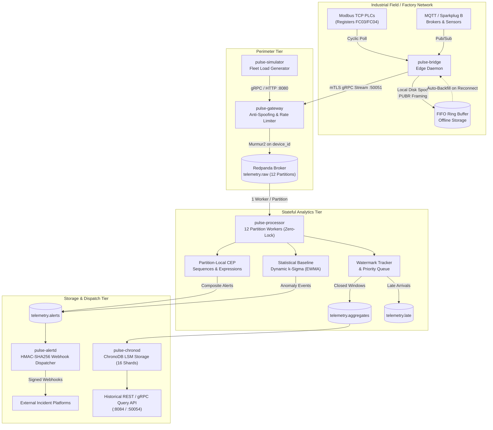

# Pulse

[](https://golang.org)
[](.github/workflows/ci.yml)
[](LICENSE)
[](deployments/docker)
[](deployments/helm/pulse)
[](ROADMAP.md)

**Pulse** is a high-throughput, low-latency industrial telemetry ingestion, stateful stream processing, and time-series storage platform written in pure Go.

Engineered for mission-critical industrial IoT, factory SCADA installations, and energy facilities, Pulse translates fieldbus protocols (MQTT v3.1.1/v5.0, Sparkplug B, Modbus TCP), buffers edge data locally during WAN network partitions, evaluates multi-stage complex events (CEP) with zero hot-path locks, and persists time-series aggregates into an embedded LSM engine (ChronoDB).

---

## Key Capabilities

- **Industrial Edge Ingestion (`pulse-bridge`)**: Ingests field telemetry via MQTT (with topic wildcards and JSON extraction), Sparkplug B binary protobuf frames, and Modbus TCP register polling (FC03/FC04) with configurable scaling and endianness.
- **Store-and-Forward Offline Buffering**: Dual-tier buffering (in-memory ring buffer + append-only disk FIFO spool with binary `PUBR` framing and CRC32 verification) guarantees zero data loss during WAN outages, flushing in strict event-time order upon reconnection.
- **Zero-Lock Hot-Path Stream Processing (`pulse-processor`)**: Dedicates exactly one worker goroutine per Redpanda partition using Murmur2 hashing on `device_id`. All per-device state, window accumulators, and anomaly baselines execute with zero cross-thread mutex contention.
- **Deterministic Event-Time Watermarking**: Monotonic watermark progression (`max_event_time - allowed_lateness`) with idle partition timeout compensation. Window closures depend strictly on watermark progression, never wall-clock time.
- **Complex Event Processing (CEP)**: In-memory partition-local pattern matcher evaluating temporal sequences (`EventA FOLLOWED_BY EventB WITHIN ΔT`) with event-time watermark candidate expiration, cross-metric arithmetic formulas, and live rule reloading via `POST /api/v1/rules/reload` and `SIGHUP`.
- **Composite Incident Synthesis**: Collapses raw cascading sensor alarms into unified root-cause incident notifications, cutting downstream alert noise by over 90%.
- **Embedded Durable Storage (ChronoDB)**: Sharded LSM disk engine with synchronous Write-Ahead Logging (WAL), immutable SSTables, Murmur3 Bloom filters, multi-way merge compaction, and sub-millisecond range queries with dynamic analytical rollups.
- **Defense-in-Depth Security**: Mutual TLS (TLS 1.3), cryptographic client identity anti-spoofing binding certificate Common Names to payload `device_id`, ChronoDB JWT Role-Based Access Control (RBAC), HMAC-SHA256 webhook signatures, and Kubernetes default-deny NetworkPolicies.
- **Air-Gapped & Cloud-Agnostic**: Pure Go (`CGO_ENABLED=0`), static compilation, zero external cloud dependencies. Deployable on bare metal, factory IPCs, edge gateways, or Kubernetes.

---

## Architecture

> 💡 **Release History & Roadmap**: For a chronological breakdown of shipped capabilities (Milestones 001–010) and planned enhancements, see **[ROADMAP.md](ROADMAP.md)**.



---

## Core Services

| Binary | Protocols & Ports | Role & Responsibility |
|---|---|---|
| **`pulse-bridge`** | Metrics: `:9095`<br/>Outbound: mTLS gRPC | Standalone edge daemon for MQTT, Sparkplug B, and Modbus TCP translation with offline FIFO disk spooling. |
| **`pulse-gateway`** | HTTP: `:8080`<br/>gRPC: `:50051` | Ingestion perimeter enforcing mTLS, pre-shared keys, device anti-spoofing, rate limiting, and Murmur2 partitioning. |
| **`pulse-processor`** | HTTP: `:8081` (Metrics, Health, Rule Reload) | Stream processing engine executing partition-local windowing, watermark tracking, $k$-sigma EWMA anomalies, and CEP rules. |
| **`pulse-chronod`** | HTTP: `:8084`<br/>gRPC: `:50054` | Polyglot time-series storage engine providing LSM-tree WAL durability, range queries, and dynamic analytical rollups. |
| **`pulse-alertd`** | HTTP: `:8083` | Decoupled asynchronous alert dispatcher with 3-state circuit breakers, retry backoff, and HMAC-SHA256 webhook signatures. |
| **`pulse-simulator`** | CLI / Kubernetes Job | Virtual fleet load generator simulating 10,000+ devices across steady-state, burst, network partition, and anomaly profiles. |

---

## Architectural Principles & Invariants

1. **Partition-Local State & Zero-Lock Ingestion**: Telemetry is partitioned by `device_id` across 12 partitions. All state (tumbling/sliding windows, EWMA statistics, CEP sequence candidates, cross-metric caches) lives in partition-local memory with zero mutex contention on the hot path.
2. **Deterministic Event-Time Semantics**: All window evaluations and sequence timeouts use sensor event timestamps (`timestamp_ns`). Windows close and candidates expire strictly when monotonic partition watermarks advance past deadlines.
3. **Idempotent Ingestion & Deduplication**: Closed window aggregates are stored under deterministic composite primary keys: `(device_id, metric_name, window_start_ns, window_end_ns)`. Replayed broker records or spooled backfills execute idempotent upserts with zero double-counting.
4. **Decoupled Asynchronous Side-Effects**: Downstream destinations (webhooks, notification endpoints, third-party APIs) are completely decoupled through Redpanda topics. Outage or latency in downstream systems causes zero backpressure on real-time stream ingestion.
5. **Explicit Storage Boundary**: Ingestion, streaming analytics, and persistent storage interact exclusively across standard Protobuf wire contracts and broker topics, never through shared memory or ad-hoc database couplings.

---

## Quickstart

### Prerequisites

- **Go**: 1.26 or later
- **Docker & Docker Compose**: v2.20+
- **Protoc** (optional, for regenerating protobufs): v3.20+

### 1. Start Redpanda Cluster

```bash
make up
# Starts single-node Redpanda with 12 partitions on telemetry.raw
```

### 2. Build All Services

```bash
make build
# Compiles: bin/gateway, bin/processor, bin/alertd, bin/chronod, bin/simulator, bin/bridge
```

### 3. Launch the Platform Services

In separate terminal sessions (or background processes):

```bash
# 1. Ingestion Gateway (HTTP :8080, gRPC :50051)
./bin/gateway

# 2. Stream Processor with CEP Engine (HTTP :8081)
./bin/processor

# 3. Decoupled Alert Dispatcher (HTTP :8083)
./bin/alertd

# 4. ChronoDB Time-Series Storage (HTTP :8084, gRPC :50054)
./bin/chronod

# 5. Industrial Edge Bridge (HTTP :9095)
./bin/bridge --config deployments/config/bridge.yaml
```

### 4. Verify Health & Ingest Test Telemetry

```bash
# Check service health
curl -s http://localhost:8080/healthz | jq   # Gateway
curl -s http://localhost:8081/healthz | jq   # Processor
curl -s http://localhost:8083/healthz | jq   # Alert Dispatcher
curl -s http://localhost:8084/healthz | jq   # ChronoDB

# Ingest single telemetry measurement via Gateway REST API
curl -X POST http://localhost:8080/api/v1/telemetry \
  -H "Content-Type: application/json" \
  -d '{
    "device_id": "turbine-alpha-01",
    "timestamp_ns": '$(date +%s%N)',
    "metric_name": "bearing_temp",
    "value": 72.8,
    "unit": "celsius"
  }' | jq

# Query historical range from ChronoDB
curl -s "http://localhost:8084/api/v1/query?device_id=turbine-alpha-01&metric_name=bearing_temp&start_time=0&end_time=2000000000000000000" | jq

# Query 1-minute analytical rollup
curl -s "http://localhost:8084/api/v1/query/rollup?device_id=turbine-alpha-01&metric_name=bearing_temp&start_time=0&end_time=2000000000000000000&step=1m" | jq
```

---

## Edge Protocol Bridge (`pulse-bridge`)

`pulse-bridge` operates on factory IPCs and edge gateways, translating heterogeneous fieldbus protocols into canonical Protobuf structures streamed upstream over mTLS gRPC.

### Configuration (`deployments/config/bridge.yaml`)

```yaml
bridge_id: "bridge-plant-alpha"
gateway_endpoint: "gateway.pulse.internal:50051"
metrics_port: ":9095"

tls_client_cert: "certs/bridge.crt"
tls_client_key: "certs/bridge.key"
tls_ca_cert: "certs/ca.crt"

spool_dir: "/var/lib/pulse/bridge"
max_spool_bytes: 5368709120 # 5 GB allocation
batch_linger: 10ms
batch_max_records: 1000

mqtt:
  - name: "plant-mqtt-telemetry"
    broker_url: "tcp://localhost:1883"
    client_id: "pulse-bridge-alpha"
    topics:
      - "factory/+/+/telemetry"
    format: "json"
    topic_pattern: "factory/{area}/{device_id}/telemetry"

  - name: "scada-sparkplug-b"
    broker_url: "tcp://localhost:1883"
    client_id: "pulse-bridge-spb"
    topics:
      - "spBv1.0/#"
    format: "sparkplug_b"

modbus:
  - name: "turbine-generator-plc"
    endpoint: "192.168.1.100:502"
    slave_id: 1
    poll_interval: 100ms
    timeout: 2s
    registers:
      - device_id: "turbine-01"
        metric_name: "bearing_temp"
        unit: "celsius"
        function_code: 3 # FC03 Holding Registers
        start_address: 40001
        data_type: "float32_be"
        multiplier: 1.0
        offset: 0.0
```

### Store-and-Forward Spooling Mechanics

```text
+-----------------------+-----------------------+-----------------------+-----------------------+
| Magic (4 bytes)       | Frame Length (4 bytes)| CRC32 (4 bytes)       | Flags (4 bytes)       |
| 0x50554252 ("PUBR")   | uint32 (Big-Endian)   | IEEE uint32           | 0x01 = Protobuf       |
+-----------------------+-----------------------+-----------------------+-----------------------+
|                       Serialized TelemetryReading Protobuf Bytes                             |
+-----------------------------------------------------------------------------------------------+
```

When upstream network connectivity drops:
1. Readings write immediately to append-only disk segments (`spool_000001.log`).
2. An atomic manifest (`manifest.json`) tracks segment write and read byte offsets.
3. Upon reconnection, segments replay in chronological FIFO sequence over gRPC streaming.
4. Old segments delete automatically after upstream receipt acknowledgment.

---

## Complex Event Processing (CEP) Engine

Embedded directly in `pulse-processor` worker goroutines, the CEP engine detects multi-stage causal failure progressions across concurrent metrics.

### Declarative Rules (`deployments/config/cep_rules.yaml`)

```yaml
rules:
  # Multi-stage temporal sequence
  - rule_id: "RULE-BEARING-CASCADE"
    name: "Bearing Thermal Runaway Cascade"
    description: "Vibration spike followed by rapid bearing temperature rise within 45s"
    device_pattern: "turbine-*"
    window_duration: 45s
    pattern_type: "SEQUENCE"
    sequence_steps:
      - step_index: 0
        metric_name: "vibration"
        condition: "z_score >= 3.5"
        z_score_threshold: 3.5
      - step_index: 1
        metric_name: "bearing_temp"
        condition: ">="
        threshold: 95.0
    severity: "CRITICAL"
    cooldown: 5m

  # Cross-metric mathematical formula
  - rule_id: "RULE-HEAT-RATE-DEGRADATION"
    name: "Turbine Thermal Efficiency Degradation"
    description: "Power output relative to fuel flow dropped below operating threshold"
    device_pattern: "turbine-*"
    window_duration: 1m
    pattern_type: "EXPRESSION"
    expression: "power_mw / fuel_flow < 0.70"
    severity: "WARNING"
    cooldown: 10m
```

### Dynamic Rule Reloading

Update rules on the fly with zero service restarts or event loss:

```bash
# Administrative REST endpoint
curl -X POST http://localhost:8081/api/v1/rules/reload | jq

# Or via SIGHUP signal
kill -HUP $(pidof processor)
```

---

## Verified Benchmarks

Executed on an Intel Core i7-1165G7 (4 cores / 8 threads @ 2.80GHz, Linux x86_64):

| Benchmark Scenario | Throughput | Latency per Op | Memory Allocation |
|---|:---:|:---:|:---:|
| **Gateway Single Reading Ingestion** | **7,046,857 events/sec** | 141.9 ns/op | 222 B/op (3 allocs) |
| **Gateway Batch Ingestion (100/batch)** | **55,624,443 events/sec** | 1,798 ns/op | 2,208 B/op (6 allocs) |
| **Statistical Baseline EWMA Update** | **175,892,947 updates/sec** | **5.68 ns/op** | 0 B/op (0 allocs) |
| **Anomaly Detector Full Evaluation** | **3,629,306 evaluations/sec** | 275.5 ns/op | 72 B/op (4 allocs) |
| **Decoupled Alert Dispatcher Pool** | **12,783,261 dispatches/sec** | **78.2 ns/op** | 0 B/op (0 allocs) |
| **ChronoDB Batch Upsert (LSM engine)** | **1,665,996 records/sec** | 60.0 µs/batch | 20,595 B/op |
| **ChronoDB Historical Range Query (1k points)** | **79,089 queries/sec** | 12.6 µs/query | 17,540 B/op (11 allocs) |
| **ChronoDB Dynamic Rollup (1h / 1m bins)** | **107,004 rollups/sec** | 9.3 µs/rollup | 16,160 B/op (75 allocs) |
| **Fleet Signal Generation (Simulator)** | **17,177,744 events/sec** | 58.2 ns/op | 112 B/op (1 alloc) |
| **12-Partition Concurrent Worker Loop** | **1,315,503 events/sec** | 760.3 ns/op | 849 B/op (5 allocs) |

---

## Observability & Dashboards

Pulse provides production-grade observability via Prometheus, Alertmanager, and declarative Grafana dashboards:

```bash
# Start observability services
make obs-up

# Print direct URLs to all dashboards
make dashboards

# Validate dashboards and alert rules
./scripts/verify_observability.sh

# Stop observability stack
make obs-down
```

### Dashboards Included (`deployments/grafana/dashboards/`)

- **Executive Overview** (`/d/pulse-executive-overview`): High-level throughput, p95 end-to-end canary latency, active anomaly incidents, and system availability.
- **Ingestion & Broker Lag** (`/d/pulse-ingest-broker-lag`): Protocol ratios, gateway latencies, per-partition consumer lag across 12 partitions.
- **Stream Processing & Watermarking** (`/d/pulse-stream-processor`): Per-partition event-time watermark progression, priority queue depth, late data drop counters.
- **Anomaly Detection & Decoupled Alerting** (`/d/pulse-anomaly-alerts`): $k$-sigma anomaly rates, circuit breaker states, webhook delivery latencies.
- **ChronoDB Storage Engine** (`/d/pulse-chronodb-storage`): 16-shard write distribution, WAL sync latency, SSTable compactions, query response latencies.

---

## Security Architecture

```text
[Edge Device / Bridge]
       │  (TLS 1.3 / mTLS + API Key)
       ▼
[pulse-gateway]
   ├─► Client Cert CN/SAN == Telemetry reading.device_id (Anti-Spoofing)
   └─► Token-Bucket Rate Limiter (HTTP 429 on surge flood)
       │
       ▼ (Redpanda Private Network)
[pulse-processor]
       │
       ├─► [pulse-chronod] (JWT RBAC: Viewer / Operator / Admin + Device Scope Glob)
       └─► [pulse-alertd]  (HMAC-SHA256 Signing + Replay Defense)
```

- **Perimeter Authentication**: Mutual TLS (TLS 1.3) with client certificate verification and constant-time API key checking.
- **Identity Anti-Spoofing**: Enforces strict binding between certificate identity (CN/SAN) and payload `device_id`, rejecting spoofed payloads with HTTP 403 / gRPC `PermissionDenied`.
- **ChronoDB RBAC**: Pure Go JWT authorization enforcing `Viewer`, `Operator`, and `Admin` permissions with `allowed_devices: ["turbine-*"]` glob isolation.
- **Webhook Integrity**: Cryptographic HMAC-SHA256 signing (`X-Pulse-Signature`, `X-Pulse-Timestamp`) with a 300s clock drift tolerance window protecting downstream notification receivers.
- **Network Isolation**: Kubernetes default-deny ingress NetworkPolicies limiting inter-pod communication to least-privilege egress channels.

---

## Production Deployment

### Container Packaging

All microservices are packaged as minimal distroless containers running as non-root (`UID 65532:65532`) with zero package managers or shell binaries:

```bash
# Build all production container images
make docker-build
```

Images generated:
- `pulse-gateway:latest`
- `pulse-processor:latest`
- `pulse-bridge:latest`
- `pulse-chronod:latest`
- `pulse-alertd:latest`
- `pulse-simulator:latest`

### Kubernetes Deployment (Helm v3)

```bash
# Lint chart templates
make helm-lint

# Render template manifests
make helm-template

# Run Kubernetes packaging verification harness
make k8s-verify
```

---

## Makefile Reference

```bash
# Build & Generation
make build             # Compiles all 6 Go binaries to bin/
make proto             # Regenerates Protobuf Go code in proto/v1/
make certs             # Generates local test CA and mTLS certificates in certs/

# Testing & Verification
make test              # Runs all unit tests with race detection (-race)
make test-security     # Runs mTLS, anti-spoofing, RBAC, and Webhook HMAC security tests
make test-edge-cep     # Runs Edge Bridge and CEP engine test suites
make bench             # Executes comprehensive platform benchmarks
make k8s-verify        # Validates Helm templates, NetworkPolicies, and Dockerfiles
make e2e               # Runs full end-to-end multi-service pipeline integration test

# Simulation & Observability
make up                # Starts Redpanda cluster via Docker Compose
make down              # Stops Redpanda cluster
make obs-up            # Starts Prometheus, Grafana, and Alertmanager
make obs-down          # Stops observability stack
make dashboards        # Displays Grafana URLs and dashboard identifiers
make sim               # Runs 50,000 ev/s load simulator verification
```

---

## Project Roadmap

Pulse follows a transparent, community-driven release roadmap. For an exhaustive architectural history of completed platform capabilities (Milestones 001–010) and upcoming enhancements (ChronoDB Raft consensus, native binary OPC-UA subscriptions, and WebAssembly UDFs), consult **[ROADMAP.md](ROADMAP.md)**.

---

## License

This project is licensed under the Apache 2.0 License. See [LICENSE](LICENSE) for details.
