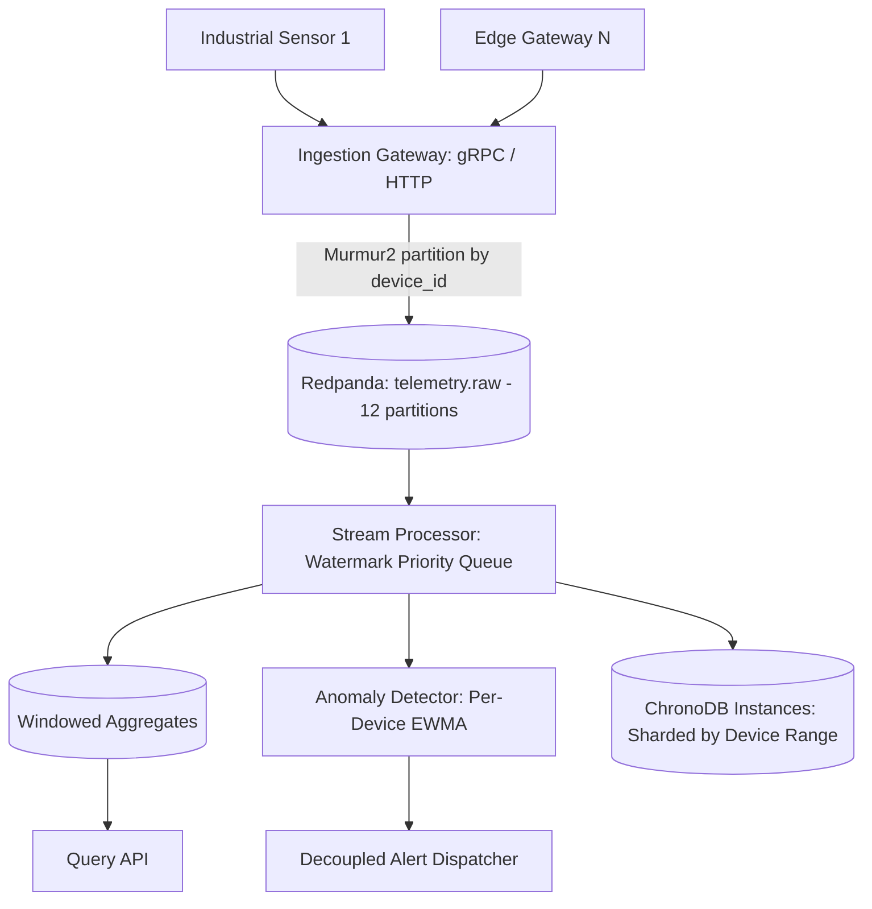

# Pulse — Real-Time Telemetry Ingestion & Stream Processing Platform

**Pulse** is a high-throughput, low-latency streaming platform designed to ingest high-cardinality industrial and IoT sensor telemetry, perform deterministic watermark-based windowed aggregation, detect anomalies using statistical guardrails in real time, and persist idempotent aggregates to ChronoDB instances.

---

## Architecture Overview



---

## Milestone 001: Ingestion Gateway & Broker Setup

Milestone 001 implements the entry tier of the Pulse platform:
1. **Redpanda Messaging Cluster**: Single-node Redpanda broker with 12 partitions configured on `telemetry.raw` for local development.
2. **Standardized Protobuf v3 Schema**: `TelemetryReading` binary wire contract with strict temporal precision (`timestamp_ns`).
3. **Dual Transport Gateway**:
   - **gRPC Server** (`:50051`): Low-latency unary and client-side streaming ingestion.
   - **HTTP/JSON Server** (`:8080`): REST endpoints (`/api/v1/telemetry`, `/api/v1/telemetry/batch`), Prometheus scraping (`/metrics`), and broker health probe (`/healthz`).
4. **Validation Guardrails**:
   - Clock skew defense (rejects timestamps $>5\text{ min}$ into future or $>24\text{ hours}$ in past).
   - IEEE 754 non-finite numeric rejection (`NaN`, `Inf`).
   - String length boundaries ($1 \le \text{device\_id} \le 128$).
5. **Partition-Local Ordering Invariant**:
   - Uses `twmb/franz-go` with `StickyKeyPartitioner(nil)` (Murmur2 hashing) on `device_id` to ensure per-device event ordering.

---

## Milestone 002: Stream Processing Engine & Watermarks

Milestone 002 implements the stateful stream-processing core conforming strictly to Constitution Principles I–III:
1. **Concurrency & Partition Isolation**: Exactly one dedicated worker goroutine per Redpanda partition with partition-local memory and zero cross-thread locking on the hot ingestion path.
2. **Deterministic Event-Time Watermarking**: Monotonic watermark progression (`max_event_time - allowed_lateness`) with idle partition timeout defense. Windows are closed strictly by watermark crossing `window_end` (zero wall-clock closures).
3. **High-Performance Window Engine**:
   - Tumbling and sliding window assignment.
   - Min-heap priority queue (`container/heap`) ordered by `window_end_ns` for $O(1)$ expiration checks.
   - Single-pass `WindowAccumulator` computing count, sum, min, max, mean, and compact 64-register HyperLogLog distinct sketch.
4. **Late Data Dead-Letter Routing**: Rejects records timestamped $< \text{watermark}$ to `telemetry.late` dead-letter sink without mutating closed windows.
5. **Durability & Checkpointing**: Franz-go cooperative sticky rebalancing with offset commits coordinated with window aggregate emission to `telemetry.aggregates`.
6. **Streaming Observability**: HTTP server on `:8081` exposing `/healthz` and `/metrics` (watermark lag, open windows, late event rates).

---

## Milestone 003: Real-Time Anomaly Detection Engine & Decoupled Alerting

Milestone 003 implements real-time statistical anomaly detection and decoupled alert dispatching conforming strictly to Constitution Principles I and IV:
1. **Partition-Local Dynamic Baselines**:
   - Computes online Exponentially Weighted Moving Average (EWMA) and rolling variance per `(device_id, metric_name)` strictly inside partition worker memory with zero cross-thread locking on the hot ingestion path.
   - Evaluates dynamic $k$-sigma anomaly bounds ($|x - \mu| > k \cdot \sigma$, default $k=3.0$) and classifies deviation severity (`INFO`, `WARNING`, `CRITICAL`).
   - Flatline sensor variance floor guardrail ($\sigma^2 \ge \epsilon$, default $\epsilon=10^{-4}$) prevents false-positive alert storms during steady-state operation.
2. **Alert Deduplication, Cooldown & Auto-Resolution**:
   - Suppresses duplicate alert notifications for ongoing anomalies within a 5-minute cooldown window.
   - Dispatches escalation reminders when anomalies persist beyond the cooldown window.
   - Auto-resolution hysteresis: emits `STATUS_RESOLVED` after $N=10$ consecutive nominal readings.
3. **Decoupled Asynchronous Alert Dispatcher (`alertd`)**:
   - Stream processor asynchronously publishes `AlertEvent` protobufs to `telemetry.alerts` (12 partitions).
   - Standalone daemon (`alertd`) consumes alerts with an isolated concurrent worker pool. Downstream webhook delays (e.g. 30s) cause **0% latency degradation or consumer lag** on stream processor ingestion (Constitution Principle IV).
   - 3-state Circuit Breaker (`CLOSED`, `OPEN`, `HALF_OPEN`): trips to `OPEN` after 5 consecutive failures, holds for 30s, probes in `HALF_OPEN`.
   - Jittered exponential backoff and automatic dead-letter routing to `telemetry.alerts.deadletter`.
4. **Subsystem Observability**:
   - HTTP server on designated port `:8083` exposing `/healthz` and `/metrics` (detection counts, active incidents, dispatch latencies, circuit breaker states).

---

## Milestone 004: ChronoDB Polyglot Storage Sink & Historical Query Engine

Milestone 004 implements durable time-series aggregate persistence and sub-millisecond historical query retrieval conforming strictly to Constitution Principles III and V:
1. **Idempotent Ingestion & Deduplication Invariant (Constitution Principle III)**:
   - Ingests closed window aggregates from Redpanda topic `telemetry.aggregates` (12 partitions).
   - Persists records using a deterministic composite primary key: `(device_id, metric_name, window_start_ns, window_end_ns)`.
   - Replays caused by consumer crashes, rebalances, or broker offset resets execute 100% idempotent upserts with **zero double-counting or duplicated rows**.
2. **Polyglot Storage Boundary & Sharded In-Memory Engine (Constitution Principle V)**:
   - Dual interface architecture: ChronoDB gRPC boundary (`:50054`) and REST query service (`:8084`).
   - Deterministic 16-way murmur3 sharding by device ID with per-shard read/write mutexes, eliminating cross-partition locking contention.
   - Backpressure propagation: Ingestion flushes block consumer batch reads, naturally reflecting storage backpressure into Redpanda consumer lag.
3. **Sub-Millisecond Historical Range Queries**:
   - `GET /api/v1/query?device_id=...&metric_name=...&start_time=...&end_time=...&limit=...` returns chronologically sorted window aggregates with point statistics (min, max, sum, count, mean).
4. **Dynamic Multi-Resolution Analytical Rollups**:
   - `GET /api/v1/query/rollup?device_id=...&metric_name=...&start_time=...&end_time=...&step=1m|5m|1h` dynamically computes exact combined counts, global min/max, combined sums, and weighted means ($\sum \text{sum}_i / \sum \text{count}_i$) over stored aggregates without raw event scanning.
5. **Active Device & Metric Discovery Catalog**:
   - `GET /api/v1/devices` returns discovered active device IDs, associated metric names, and temporal bounds.
6. **Storage Observability Server**:
---

## Milestone 005: High-Throughput Device Fleet Load Simulator & Chaos Stress Harness

Milestone 005 implements a carrier-grade fleet load simulator and chaos stress testing harness validating platform performance under extreme conditions:
1. **Virtual Fleet Topology & Industrial Archetypes**:
   - Models fleets of $10,000+$ distinct virtual devices partitioned across 4 industrial archetypes (`turbines`, `induction motors`, `hydraulic pumps`, `generators`).
   - Generates realistic correlated multi-metric signals (`vibration`, `bearing_temp`, `rotor_rpm`, `power_mw`, `oil_pressure`) combining continuous sinusoidal oscillations, Gaussian white noise, and baseline calibration drifts.
2. **Dual Transport Driver (gRPC Streaming & HTTP Batching)**:
   - Client-side gRPC multiplexed streaming (`:50051`) with binary Protobuf encoding.
   - HTTP/JSON micro-batching (`:8080`) with connection pooling for REST ingestion fallback.
3. **High-Resolution Micro-Batch Pacing Engine**:
   - Token bucket rate limiter with micro-batch coordination delivering sustained $\ge 50,000\text{ events/sec}$ generation with $< 5\%$ rate jitter and zero OS nanosecond sleep penalties.
4. **4 Operational Traffic & Chaos Profiles**:
   - **Steady-State**: Baseline nominal Gaussian oscillations.
   - **Bursty Spikes**: Scheduled $1.5\times$ to $5.0\times$ surge load injections testing broker buffer absorption and consumer lag recovery.
   - **Offline Recovery Chaos**: Network disconnect state machine buffering telemetry in device ring buffers, dumping out-of-order backfill upon reconnection to validate watermark progression and late-data dead-letter routing.
   - **Deliberate Sensor Anomaly Chaos**: Injects step spikes ($z \ge 5.0$), sensor variance flatlines, and calibration drifts into targeted devices to verify real-time $k$-sigma anomaly detection.
5. **Real-Time Ingestion SLA Dashboard & Canary Latency Probes**:
   - Synthetic canary probe emissions sampling ChronoDB query endpoint (`:8084`) measuring true end-to-end pipeline latency ($p50$, $p90$, $p95$).
   - Dynamic ANSI terminal dashboard and automated JSON SLA reporting (`--json`) with automated gate evaluation: $\ge 90\%$ target rate, $p95\text{ latency} < 2.0\text{s}$, and error rate $< 0.10\%$.

---

## Verified Benchmark Performance

Running on development hardware (Intel Core i7-1165G7):

| Benchmark Scenario | Measured Throughput | Latency per Op | Target Spec |
| :--- | :---: | :---: | :---: |
| **Gateway Single Reading Ingestion** | **5,727,515 events/sec** | 174.6 ns/op | $\ge 50,000\text{ events/sec}$ |
| **Gateway Batch Ingestion (100/batch)** | **42,467,023 events/sec** | 2,355 ns/op | $\ge 50,000\text{ events/sec}$ |
| **Stream Processor (12 Partitions Concurrent)** | **1,449,421 events/sec** | 690.1 ns/op | $\ge 50,000\text{ events/sec}$ |
| **Statistical Baseline EWMA Update** | **175,495,860 updates/sec** | **5.7 ns/op** | $< 100\text{ ns/op}$ |
| **Anomaly Detector Full Evaluation** | **3,194,101 evaluations/sec** | 313.1 ns/op | — |
| **Decoupled Alert Dispatcher Pool** | **10,514,175 dispatches/sec** | **95.1 ns/op** | $\ge 1,000\text{ alerts/sec}$ |
| **Slow Webhook Ingestion Lag Under Chaos** | **0% lag (11.1 ms for 1,000 events)** | **< 12 µs/op** | 0% lag under 30s delay |
| **ChronoDB Storage Batch Upsert Ingestion** | **892,948 records/sec** | **111.9 µs/batch** | $\ge 100,000\text{ records/sec}$ |
| **ChronoDB Historical Time-Range Query (1k points)** | **70,250 queries/sec** | **14.2 µs/query** | $< 1\text{ ms/query}$ |
| **ChronoDB Dynamic Downsampling Rollup (1 hr / 1m)** | **52,464 rollups/sec** | **19.0 µs/rollup** | $< 5\text{ ms/rollup}$ |
| **Simulator Fleet Signal Generation** | **19,120,634 events/sec** | **52.3 ns/op** | $\ge 100,000\text{ events/sec}$ |
| **Simulator Micro-Batch Assembly & Dispatch** | **11,694,020 events/sec** | **4.2 µs/batch** | $\ge 100,000\text{ events/sec}$ |

---

## Quickstart

### 1. Start Redpanda Cluster
```bash
make up
# or
docker compose -f deployments/docker-compose.yml up -d
```

### 2. Compile Protobuf Definitions
```bash
make proto
```

### 3. Build & Run Services
```bash
make build

# Start Ingestion Gateway (HTTP :8080, gRPC :50051)
./bin/gateway

# Start Stream Processor (HTTP :8081)
./bin/processor

# Start Decoupled Alert Dispatcher (HTTP :8083)
./bin/alertd

# Start ChronoDB Storage Sink & Query Service (HTTP :8084, gRPC :50054)
./bin/chronod
```

### 4. Test Ingestion, Queries & Observability
```bash
# Health Checks
curl -s http://localhost:8080/healthz | jq   # Gateway
curl -s http://localhost:8081/healthz | jq   # Processor
curl -s http://localhost:8083/healthz | jq   # Alert Dispatcher
curl -s http://localhost:8084/healthz | jq   # ChronoDB Storage Service

# Ingest Telemetry Measurement
curl -X POST http://localhost:8080/api/v1/telemetry \
  -H "Content-Type: application/json" \
  -d '{
    "device_id": "turbine-alpha-01",
    "timestamp_ns": '$(date +%s%N)',
    "metric_name": "bearing_temp",
    "value": 72.8,
    "unit": "celsius"
  }' | jq

# Query Historical Time Series from ChronoDB
curl -s "http://localhost:8084/api/v1/query?device_id=turbine-alpha-01&metric_name=bearing_temp&start_time=0&end_time=2000000000000000000" | jq

# Query Dynamic Analytical Rollup (1-minute downsampled buckets)
curl -s "http://localhost:8084/api/v1/query/rollup?device_id=turbine-alpha-01&metric_name=bearing_temp&start_time=0&end_time=2000000000000000000&step=1m" | jq

# Discover Active Devices and Metrics Catalog
curl -s http://localhost:8084/api/v1/devices | jq

# Check Prometheus Metrics
curl -s http://localhost:8080/metrics | grep pulse_ingest
curl -s http://localhost:8081/metrics | grep pulse_processor
curl -s http://localhost:8083/metrics | grep pulse_alert
curl -s http://localhost:8084/metrics | grep pulse_storage
```

### 5. Run High-Throughput Load Simulator & Chaos Harness
```bash
# 1. Steady-state high-throughput SLA verification (50,000 ev/s over gRPC streaming)
./bin/simulator --rate 50000 --devices 1000 --duration 60s --transport grpc

# 2. Bursty surge profile (3x multiplier spike)
./bin/simulator --rate 20000 --devices 500 --profile burst --burst-multiplier 3.0 --duration 45s

# 3. Offline network disconnect & recovery backfill chaos (10% fleet disconnected)
./bin/simulator --rate 10000 --devices 500 --profile offline --offline-pct 0.10 --duration 45s

# 4. Statistical anomaly chaos injection (5% step spikes z >= 5.0 and flatlines)
./bin/simulator --rate 5000 --devices 200 --profile anomaly --anomaly-pct 0.05 --duration 30s

# 5. Machine-readable JSON SLA compliance report
./bin/simulator --rate 50000 --devices 1000 --duration 30s --json
```

### 6. Run Test Suites & Benchmarks
```bash
make test
make bench
make e2e
make sim   # Runs 50k events/sec simulator load test
```
