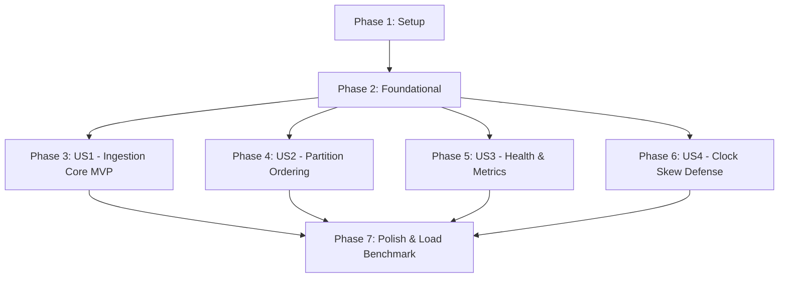

# Tasks: Telemetry Ingestion and Ingestion Gateway

**Feature**: `001-telemetry-ingestion`
**Plan**: `specs/001-telemetry-ingestion/plan.md`
**Spec**: `specs/001-telemetry-ingestion/spec.md`

---

## Phase 1: Setup (Shared Infrastructure)

**Purpose**: Project initialization, dependency management, and local container orchestration.

- [ ] T001 Initialize Go module `github.com/losercreates/pulse` and install dependencies (`github.com/twmb/franz-go`, `google.golang.org/grpc`, `google.golang.org/protobuf`, `github.com/prometheus/client_golang`, `github.com/stretchr/testify`) in `go.mod`
- [ ] T002 [P] Create Docker Compose file with single-node Redpanda broker and `telemetry.raw` (12 partitions) topic provisioning in `deployments/docker-compose.yml`
- [ ] T003 [P] Create Makefile with `build`, `proto`, `up`, `down`, `test`, and `bench` targets in `Makefile`

---

## Phase 2: Foundational (Blocking Prerequisites)

**Purpose**: Core schemas, configuration, and shared Kafka producer infrastructure required by all user stories.

**⚠️ CRITICAL**: No user story work can begin until this phase is complete.

- [ ] T004 Compile Protobuf v3 contract from `specs/001-telemetry-ingestion/contracts/telemetry.proto` generating Go stubs in `proto/v1/telemetry.pb.go` and `proto/v1/telemetry_grpc.pb.go`
- [ ] T005 [P] Implement application configuration loader with environment variables (`REDPANDA_BROKERS`, `HTTP_PORT`, `GRPC_PORT`, `TOPIC_RAW`) in `internal/gateway/config/config.go`
- [ ] T006 [P] Implement Prometheus metrics registry with record counters, byte counters, and latency histograms in `internal/gateway/metrics/metrics.go`
- [ ] T007 Implement Franz-go Kafka producer wrapper with Murmur2 hash partitioner on `device_id` in `internal/gateway/producer/producer.go`

**Checkpoint**: Foundation ready — user story implementation can now begin.

---

## Phase 3: User Story 1 - Real-Time Telemetry Transmission (Priority: P1) 🎯 MVP

**Goal**: Industrial sensors and edge gateways can emit telemetry readings via gRPC and HTTP/JSON endpoints and receive immediate acknowledgements upon dispatch to Redpanda.

**Independent Test**: Transmit single and batched JSON payloads to `POST /api/v1/telemetry` and gRPC `IngestReading`, verifying HTTP 202 / gRPC OK response and record arrival in Redpanda.

### Tests for User Story 1

- [ ] T008 [P] [US1] Create unit tests for IngestionService business logic mocking producer dispatch in `internal/gateway/service/ingestion_test.go`

### Implementation for User Story 1

- [ ] T009 [US1] Implement IngestionService coordinating validation and producer dispatch in `internal/gateway/service/ingestion.go`
- [ ] T010 [P] [US1] Implement HTTP server endpoints `POST /api/v1/telemetry` and `POST /api/v1/telemetry/batch` in `internal/gateway/server/http.go`
- [ ] T011 [P] [US1] Implement gRPC server `IngestionServiceServer` supporting `IngestReading`, `IngestBatch`, and `IngestStream` in `internal/gateway/server/grpc.go`
- [ ] T012 [US1] Implement main entrypoint bootstrapping concurrent HTTP (:8080) and gRPC (:50051) servers with graceful shutdown in `cmd/gateway/main.go`

**Checkpoint**: At this point, User Story 1 is fully functional and delivers the core ingestion MVP.

---

## Phase 4: User Story 2 - Device-Partitioned Ordered Message Delivery (Priority: P1)

**Goal**: Guarantee that 100% of telemetry readings for any given `device_id` are consistently mapped to the exact same partition in `telemetry.raw` to preserve event ordering.

**Independent Test**: Publish 1,000 readings for `device-4921` concurrently and verify that all consumed records from Redpanda belong to a single partition.

### Implementation for User Story 2

- [ ] T013 [P] [US2] Implement deterministic key partitioner test verifying `device_id` hash distribution in `internal/gateway/producer/producer_test.go`
- [ ] T014 [US2] Write end-to-end integration test verifying per-device partition consistency against Redpanda in `tests/integration/partitioning_test.go`

**Checkpoint**: User Stories 1 and 2 deliver high-throughput, partition-ordered ingestion matching Constitution Principle I.

---

## Phase 5: User Story 3 - Ingestion Health & Operational Telemetry (Priority: P2)

**Goal**: Expose system health and Prometheus metrics to give operators continuous visibility into throughput, latency, and broker connection status.

**Independent Test**: Query `GET /healthz` and `GET /metrics` and verify cluster readiness and counter updates.

### Implementation for User Story 3

- [ ] T015 [P] [US3] Implement health check handler testing live Redpanda broker metadata connection at `GET /healthz` in `internal/gateway/server/health.go`
- [ ] T016 [P] [US3] Implement HTTP and gRPC metrics instrumentation middleware recording request latency and payload size in `internal/gateway/server/middleware.go`

**Checkpoint**: Operational probes and Prometheus monitoring are operational.

---

## Phase 6: User Story 4 - Clock Skew and Malformed Payload Defense (Priority: P2)

**Goal**: Guard downstream watermarking against clock skew by rejecting future timestamps $> 5$ minutes, past timestamps $> 24$ hours, non-finite doubles (`NaN`, `Inf`), and malformed identifiers.

**Independent Test**: Send payloads with skewed timestamps and non-finite values, verifying HTTP 400 / gRPC `InvalidArgument` and rejection counter increment.

### Tests for User Story 4

- [ ] T017 [P] [US4] Write unit tests covering clock skew bounds, string lengths, and non-finite numbers in `internal/gateway/validator/validator_test.go`

### Implementation for User Story 4

- [ ] T018 [US4] Implement payload validator checking `1 <= len(device_id) <= 128`, `1 <= len(metric_name) <= 128`, `now - 24h <= timestamp_ns <= now + 5m`, and `!math.IsNaN(value) && !math.IsInf(value, 0)` in `internal/gateway/validator/validator.go`
- [ ] T019 [US4] Integrate validator into `IngestionService` returning detailed `ValidationError` responses in `internal/gateway/service/ingestion.go`

**Checkpoint**: Downstream pipeline is defended against corrupted edge device clocks and bad payloads.

---

## Phase 7: Polish & Cross-Cutting Concerns

**Purpose**: Performance benchmarking, integration test suite, and operational verification.

- [ ] T020 [P] Implement concurrent ingestion load benchmark targeting $\ge 50,000\text{ events/sec}$ in `tests/bench/throughput_test.go`
- [ ] T021 [P] Implement end-to-end integration test suite validating scenarios from `quickstart.md` in `tests/integration/gateway_test.go`
- [ ] T022 [P] Document local run and benchmark instructions in `README.md`

---

## Dependencies & Execution Order

### Phase Dependencies

### User Story Dependencies

- **US1 (Core Ingestion)**: Depends only on Foundational (Phase 2). Delivers MVP.
- **US2 (Partitioning)**: Depends on Foundational producer; can execute in parallel with US1.
- **US3 (Health & Metrics)**: Depends on HTTP/gRPC server structure from US1; independent handlers.
- **US4 (Clock Skew Defense)**: Depends on validator package; can execute in parallel and integrate into US1.

### Parallel Opportunities

- **Phase 1**: T002 (docker-compose) and T003 (Makefile) can run in parallel.
- **Phase 2**: T005 (config) and T006 (metrics) can run in parallel.
- **Phase 3**: T010 (HTTP server) and T011 (gRPC server) can be developed in parallel after T009.
- **Phase 5 & 6**: T015 (health handler), T016 (metrics middleware), and T017/T018 (validator) are completely orthogonal files and can run in parallel.

---

## Implementation Strategy

### MVP First (User Story 1 Only)
1. Complete Phase 1 (Setup: Go module, Docker Compose).
2. Complete Phase 2 (Foundational: Protobuf generation, Franz-go producer).
3. Complete Phase 3 (US1: Core IngestionService, HTTP and gRPC endpoints).
4. **Validate MVP**: Ingest test payloads via `curl` and verify arrival in Redpanda.

### Incremental Delivery
- Step 1: Validate MVP (US1).
- Step 2: Validate Partitioning (US2).
- Step 3: Validate Health & Metrics (US3).
- Step 4: Validate Clock Skew Defense (US4).
- Step 5: Execute 50,000 events/sec benchmark (Polish).
