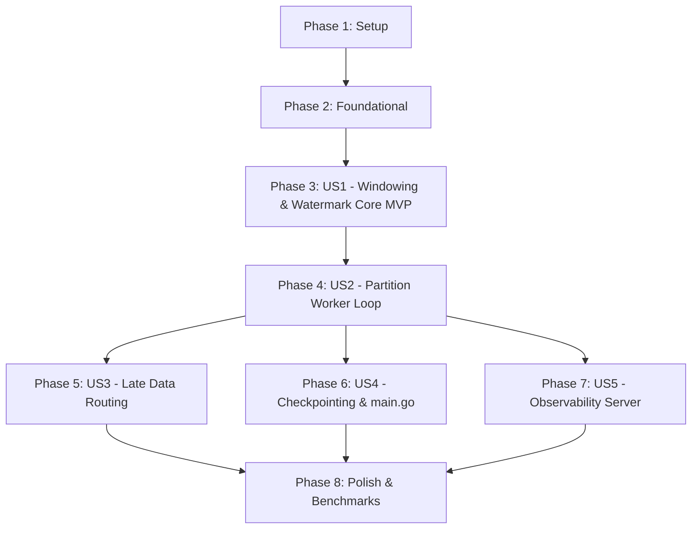

# Tasks: Stream Processing Engine and Event-Time Watermarking

**Feature**: `002-stream-processor-core`
**Plan**: [plan.md](file:///home/mayukh/projects/pulse/specs/002-stream-processor-core/plan.md)
**Spec**: [spec.md](file:///home/mayukh/projects/pulse/specs/002-stream-processor-core/spec.md)

---

## Phase 1: Setup (Shared Infrastructure)

**Purpose**: Topic provisioning in Docker Compose and build automation for stream processing.

- [X] T001 [P] Update `deployments/docker-compose.yml` to provision topics `telemetry.aggregates` (12 partitions) and `telemetry.late` (12 partitions) in `deployments/docker-compose.yml`
- [X] T002 [P] Update `Makefile` with `proto` targets to compile `aggregates.proto` and build `cmd/processor` in `Makefile`

---

## Phase 2: Foundational (Blocking Prerequisites)

**Purpose**: Core Protobuf contracts, stream processor configuration, and Prometheus metrics registry.

**⚠️ CRITICAL**: No user story work can begin until this phase is complete.

- [X] T003 Compile Protobuf v3 contract from `specs/002-stream-processor-core/contracts/aggregates.proto` into `proto/v1/aggregates.pb.go`
- [X] T004 [P] Implement stream processor configuration loader (`STREAM_ALLOWED_LATENESS` default "5s", `STREAM_IDLE_TIMEOUT` default "10s", `TUMBLING_WINDOW_SIZE`, `SLIDING_WINDOW_SIZE`, `SLIDING_SLIDE_SIZE`) in `internal/processor/config/config.go`
- [X] T005 [P] Implement streaming Prometheus metrics instrumentation (watermark lag, open windows, late records, window close latency) in `internal/processor/metrics/metrics.go`

**Checkpoint**: Foundation ready — user story implementation can now begin.

---

## Phase 3: User Story 1 - Deterministic Out-of-Order Windowed Aggregation (Priority: P1) 🎯 MVP

**Goal**: Accurately aggregate high-frequency telemetry into tumbling and sliding windows governed strictly by event-time watermarks, correctly handling out-of-order data within the allowed lateness bound.

**Independent Test**: Feed an out-of-order sequence of telemetry records into the window manager and verify that windows close strictly when the event-time watermark advances past `window_end` with mathematically correct statistical rollups.

### Tests for User Story 1

- [X] T006 [P] [US1] Create unit tests for monotonic watermark progression, allowed lateness calculation, and idle partition advancement in `internal/processor/watermark/watermark_test.go`
- [X] T007 [P] [US1] Create unit tests for tumbling/sliding window boundary assignment, min-heap priority queue ordering, and HLL distinct estimation in `internal/processor/window/window_test.go`

### Implementation for User Story 1

- [X] T008 [US1] Implement event-time `WatermarkTracker` tracking `max_event_time_ns` and computing `current_watermark_ns = max_event_time_ns - allowed_lateness_ns` with verbatim constraint `"allowed_lateness_ns: Configurable allowed lateness bound (default: 5 seconds)"` and idle heartbeat progression in `internal/processor/watermark/watermark.go`
- [X] T009 [US1] Implement tumbling (`WindowStart = floor(T / D) * D`, `WindowEnd = WindowStart + D`) and sliding (`T - D < W_s <= T and W_s mod S == 0`) window boundary calculation with `WindowKey` constraints (`"device_id: Machine or sensor identifier (1 to 128 characters)"`, `"window_start_ns: inclusive"`, `"window_end_ns: exclusive"`) in `internal/processor/window/window.go`
- [X] T010 [US1] Implement Min-Heap Priority Queue (`container/heap`) ordered by `window_end_ns` for $O(1)$ window expiration discovery with `"heap_index: Internal index in the partition min-heap priority queue"` in `internal/processor/window/priority_queue.go`
- [X] T011 [US1] Implement single-pass `WindowAccumulator` computing count, sum, min, max, mean, and compact `"hll_registers: [64]uint8"` HyperLogLog distinct sketch in `internal/processor/window/accumulator.go`
- [X] T012 [US1] Implement in-memory `WindowManager` coordinating window lifecycle, record accumulation, and watermark-triggered emission in `internal/processor/window/manager.go`

**Checkpoint**: User Story 1 is functional and delivers the core watermark-based windowing MVP.

---

## Phase 4: User Story 2 - Partition-Local Parallel Processing & Concurrency Isolation (Priority: P1)

**Goal**: Scale horizontally across all Redpanda partitions by assigning exactly one worker goroutine per partition with partition-local memory and zero cross-thread locking on the hot ingestion path.

**Independent Test**: Process multi-partition records concurrently and verify complete independence of partition state without lock contention.

### Tests for User Story 2

- [X] T013 [P] [US2] Create unit and mock tests for partition worker loop and lifecycle management in `internal/processor/consumer/worker_test.go`

### Implementation for User Story 2

- [X] T014 [US2] Implement dedicated partition worker goroutine managing partition-local watermark and window state with zero hot-path locks in `internal/processor/consumer/worker.go`
- [X] T015 [US2] Implement Franz-go consumer group orchestrator with `kgo.CooperativeStickyBalancers()` spawning and revoking partition workers in `internal/processor/consumer/group.go`

**Checkpoint**: User Stories 1 and 2 deliver partition-parallel, lock-free stream aggregation conforming to Constitution Principle I.

---

## Phase 5: User Story 3 - Late Data Routing and Dead-Letter Isolation (Priority: P2)

**Goal**: Preserve closed window immutability by diverting late-arriving records ($< \text{watermark}$) to the dead-letter topic `telemetry.late`.

**Independent Test**: Transmit events older than the current watermark and confirm they are published to `telemetry.late` without reopening or modifying closed windows.

### Tests for User Story 3

- [X] T016 [P] [US3] Create unit tests for late event detection and dead-letter record serialization in `internal/processor/latesink/latesink_test.go`

### Implementation for User Story 3

- [X] T017 [US3] Implement `LateDataSink` publishing late-arriving records to `telemetry.late` with verbatim constraint `"lateness_duration_ns: Latency beyond watermark (watermark - timestamp_ns)"` in `internal/processor/latesink/latesink.go`
- [X] T018 [US3] Integrate late data routing into partition worker loop preserving closed window immutability in `internal/processor/consumer/worker.go`

**Checkpoint**: Closed windows are immutable; late data is captured and audited without corrupting published aggregates.

---

## Phase 6: User Story 4 - Offset Checkpointing and Crash Recovery (Priority: P2)

**Goal**: Guarantee at-least-once processing durability by committing consumer offsets to Redpanda only after window aggregates are published or checkpointed.

**Independent Test**: Terminate processor mid-stream, restart, and verify that consumption resumes from the last committed offset and re-aggregates idempotently.

### Implementation for User Story 4

- [X] T019 [US4] Implement checkpoint manager committing consumer offsets to Redpanda coordinated with aggregate emissions in `internal/processor/consumer/checkpoint.go`
- [X] T020 [US4] Implement main entrypoint bootstrapping partition consumer group, aggregate publisher, and graceful OS shutdown in `cmd/processor/main.go`

**Checkpoint**: Stream processor survives restarts and rebalances with zero lost or double-counted aggregates.

---

## Phase 7: User Story 5 - Real-Time Streaming Observability (Priority: P3)

**Goal**: Expose internal metrics for watermark lag, open window count, late data rate, and partition lag to Prometheus.

**Independent Test**: Scrape `/metrics` on port `:8081` while streaming traffic and verify metric updates.

### Implementation for User Story 5

- [X] T021 [P] [US5] Expose HTTP server for Prometheus scraping (`/metrics`) and processor health probe (`/healthz`) on port `:8081` in `internal/processor/server/http.go`

---

## Phase 8: Polish & Invariant Testing

**Purpose**: Performance benchmarking, property-based testing, and documentation.

- [X] T022 [P] Implement property-based test proving window aggregates are invariant to event arrival order within allowed lateness bound in `tests/property/order_invariance_test.go`
- [X] T023 [P] Implement stream processing load benchmark targeting $\ge 50,000\text{ events/sec}$ across 12 partitions in `tests/bench/processor_bench_test.go`
- [X] T024 [P] Update `README.md` and `quickstart.md` with stream processor execution instructions and benchmark results in `README.md`

---

## Dependencies & Execution Order

### Phase Dependencies

### User Story Dependencies

- **US1 (Core Windowing & Watermark)**: Can be developed and tested purely in-memory with unit tests (T006–T012). Delivers MVP.
- **US2 (Partition Worker Loop)**: Integrates US1 into the Franz-go consumer loop per partition (T013–T015).
- **US3 (Late Data Sink)**: Hooks into worker loop to divert late events to `telemetry.late` (T016–T018).
- **US4 (Checkpointing & main.go)**: Wires the complete service entrypoint and handles offset commits (T019–T020).
- **US5 (Observability Server)**: Exposes `:8081` HTTP server for Prometheus scraping (T021).
- **Polish (Invariance & Benchmark)**: Property tests and load benchmarks (T022–T024).

### Parallel Opportunities

- **Phase 1**: T001 (docker-compose) and T002 (Makefile) can run in parallel.
- **Phase 2**: T004 (config) and T005 (metrics) can run in parallel.
- **Phase 3**: T006/T007 (unit tests) can run in parallel. Once ready, T008 (watermark) and T009/T010/T011 (window structures) can be implemented in parallel.
- **Phase 7 & 8**: T021 (metrics server), T022 (property tests), and T023 (benchmarks) are orthogonal files and can run in parallel.

---

## Implementation Strategy

### MVP First (User Story 1 Only)
1. Complete Phase 1 (Docker Compose topics, Makefile).
2. Complete Phase 2 (Protobuf `aggregates.proto` generation, config, metrics).
3. Complete Phase 3 (US1: WatermarkTracker, WindowAccumulator, PriorityQueue, WindowManager).
4. **Validate MVP**: Run unit tests in `internal/processor/watermark/` and `internal/processor/window/` verifying watermark window closures and out-of-order handling.

### Incremental Delivery
- Step 1: Validate In-Memory Windowing & Watermarking (US1).
- Step 2: Validate Partition Worker Loop with Redpanda (US2).
- Step 3: Validate Late Data Dead-Letter Routing (US3).
- Step 4: Validate Checkpointing and Application Bootstrap (US4).
- Step 5: Validate Observability (`/metrics` on `:8081`) (US5).
- Step 6: Execute Property-Based Invariance Test & 50,000 events/sec Benchmark (Polish).
