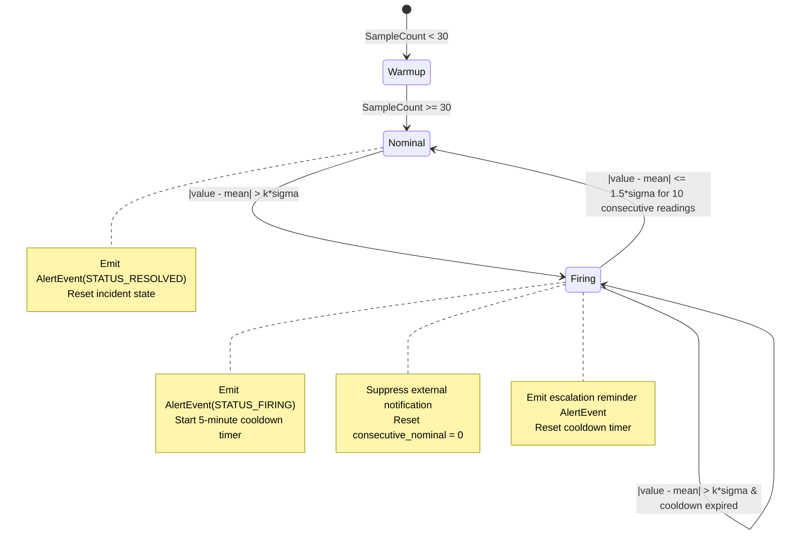

# Phase 1 Data Model: Real-Time Anomaly Detection & Decoupled Alerting

**Feature**: `003-anomaly-detection-alerts`
**Date**: 2026-10-22
**Status**: Complete

---

## 1. Domain Entities & Schemas

### Entity: `StatisticalBaseline`
Maintains the partition-local dynamic statistical state per device and metric.

| Field Name | Type | Description | Verbatim Constraints |
| :--- | :--- | :--- | :--- |
| `device_id` | `string` | Unique device identifier. | Machine or sensor identifier (1 to 128 characters). |
| `metric_name` | `string` | Measured physical quantity. | Standard telemetry metric (e.g., `bearing_temp`). |
| `mean` | `float64` | Current EWMA mean estimate. | Updated via $\mu_t = \mu_{t-1} + \alpha(x_t - \mu_{t-1})$. |
| `variance` | `float64` | Current rolling variance. | $\sigma^2_t = (1 - \alpha)(\sigma^2_{t-1} + \alpha \delta_t^2)$, guarded by $\sigma^2 \ge \epsilon$. |
| `sample_count` | `uint64` | Total readings observed. | Minimum $N_{\text{warmup}} = 30$ samples before alert evaluation. |
| `last_update_ns`| `int64` | Timestamp of latest event. | Epoch timestamp in nanoseconds. |
| `is_firing` | `bool` | Current anomaly incident state. | `true` if active anomaly is unsuppressed/unresolved. |
| `last_alert_time_ns` | `int64` | Timestamp of last dispatched alert. | Used for cooldown suppression (default: 5 minutes). |
| `consecutive_nominal` | `int` | Consecutive readings within $1.5\sigma$. | Hysteresis counter for auto-resolution (threshold $N = 10$). |

---

### Entity: `AnomalyScore`
The evaluated result of comparing a telemetry reading against its statistical baseline.

| Field Name | Type | Description |
| :--- | :--- | :--- |
| `is_anomaly` | `bool` | True if $|x - \mu| > k \times \sigma$. |
| `severity` | `AlertSeverity` | `SEVERITY_INFO` ($2.5 \le z < 3.0$), `SEVERITY_WARNING` ($3.0 \le z < 5.0$), or `SEVERITY_CRITICAL` ($z \ge 5.0$). |
| `z_score` | `float64` | Standardized deviation $|x - \mu| / \sigma$. |
| `expected_mean`| `float64` | Learned baseline mean at evaluation time. |
| `std_dev` | `float64` | Standard deviation $\sqrt{\max(\sigma^2, \epsilon)}$. |
| `trigger_value`| `float64` | Observed measurement value. |

---

### Entity: `AlertEvent` (Protobuf Wire Contract)
Published to broker topic `telemetry.alerts` (12 partitions) for asynchronous dispatching.

| Field Name | Type | Description |
| :--- | :--- | :--- |
| `alert_id` | `string` | Unique alert identifier (UUIDv4). |
| `device_id` | `string` | Source device identifier. |
| `metric_name` | `string` | Telemetry metric name. |
| `trigger_value`| `double` | Observed sensor reading. |
| `expected_mean`| `double` | Nominal mean at trigger time. |
| `standard_deviation` | `double` | Baseline $\sigma$ at trigger time. |
| `z_score` | `double` | Standardized deviation score. |
| `severity` | `AlertSeverity` | `INFO`, `WARNING`, or `CRITICAL`. |
| `status` | `AlertStatus` | `STATUS_FIRING` or `STATUS_RESOLVED`. |
| `timestamp_ns` | `int64` | Event occurrence timestamp in nanoseconds. |
| `partition_id` | `int32` | Kafka/Redpanda partition number that detected the anomaly. |

---

### Entity: `CircuitBreakerState`
Tracks health of external alert sinks to prevent thread starvation and cascade failures.

| Field Name | Type | Description |
| :--- | :--- | :--- |
| `sink_name` | `string` | Identifier or URL of the downstream notification sink. |
| `state` | `enum` | `CLOSED` (Normal), `OPEN` (Tripped), `HALF_OPEN` (Probing). |
| `consecutive_failures` | `int` | Failure counter (Trips to `OPEN` when $\ge 5$). |
| `cooldown_duration` | `time.Duration`| Duration to hold in `OPEN` state (default: $30\text{ seconds}$). |
| `last_state_change` | `time.Time` | Timestamp of the last state transition. |

---

## 2. State Machine Transitions

