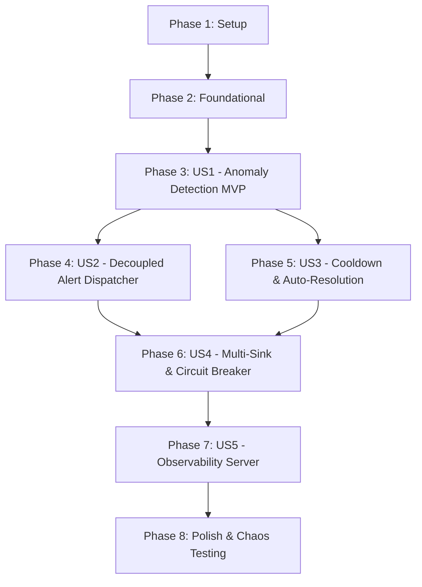

# Tasks: Real-Time Anomaly Detection & Decoupled Alerting

**Feature**: `003-anomaly-detection-alerts`
**Plan**: [plan.md](file:///home/mayukh/projects/pulse/specs/003-anomaly-detection-alerts/plan.md)
**Spec**: [spec.md](file:///home/mayukh/projects/pulse/specs/003-anomaly-detection-alerts/spec.md)

---

## Phase 1: Setup (Shared Infrastructure)

**Purpose**: Topic provisioning in Docker Compose and build automation for alert contracts and dispatcher daemon.

- [X] T001 [P] Update `deployments/docker-compose.yml` to provision topic `telemetry.alerts` (12 partitions) in `deployments/docker-compose.yml`
- [X] T002 [P] Update `Makefile` with targets to compile `alerts.proto` and build `cmd/alertd` in `Makefile`

---

## Phase 2: Foundational (Blocking Prerequisites)

**Purpose**: Protobuf contracts, alert configuration loader, and Prometheus metrics registry.

**⚠️ CRITICAL**: No user story work can begin until this phase is complete.

- [X] T003 Compile Protobuf v3 contract from `specs/003-anomaly-detection-alerts/contracts/alerts.proto` into `proto/v1/alerts.pb.go`
- [X] T004 [P] Implement alert system configuration loader (`ALERT_EWMA_ALPHA`, `ALERT_K_SIGMA`, `ALERT_VARIANCE_EPSILON`, `ALERT_COOLDOWN_DURATION`, `ALERT_WEBHOOK_URL`) in `internal/alert/config/config.go`
- [X] T005 [P] Implement Prometheus metrics registry (anomaly rates, active firing alerts, dispatch latency histogram, circuit breaker states) in `internal/alert/metrics/metrics.go`

**Checkpoint**: Foundation ready — user story implementation can now begin.

---

## Phase 3: User Story 1 - Real-Time Statistical Anomaly Detection (Priority: P1) 🎯 MVP

**Goal**: Learn online statistical baselines per `(device_id, metric_name)` in partition-local memory and flag $k$-sigma deviations in real time with flatline variance guardrails.

**Independent Test**: Ingest 50 nominal telemetry readings to train the baseline, then inject a spike reading ($z > 3.0$). Verify that an anomaly is detected immediately and that flatline signals with near-zero variance do not trigger false alert storms.

### Tests for User Story 1

- [X] T006 [P] [US1] Create unit tests for online EWMA mean, rolling variance updates, warmup threshold, and variance floor guardrail in `internal/alert/detector/baseline_test.go`

### Implementation for User Story 1

- [X] T007 [US1] Implement `StatisticalBaseline` tracking EWMA mean and rolling variance with verbatim constraints `"Minimum N_warmup = 30 samples before alert evaluation"` and `"guarded by sigma^2 >= epsilon"` with `"device_id: Machine or sensor identifier (1 to 128 characters)"` in `internal/alert/detector/baseline.go`
- [X] T008 [US1] Implement `AnomalyDetector` evaluating $|value - \text{EWMA}| > k \times \sigma$ and classifying severity (`INFO`, `WARNING`, `CRITICAL`) based on $z$-score in `internal/alert/detector/detector.go`
- [X] T009 [US1] Integrate `AnomalyDetector` into the stream processor partition worker loop with zero hot-path locks in `internal/processor/consumer/worker.go`

**Checkpoint**: User Story 1 is functional and delivers the core partition-local statistical anomaly detection MVP.

---

## Phase 4: User Story 2 - Decoupled Asynchronous Alert Dispatching (Priority: P1)

**Goal**: Enforce Constitution Principle IV by decoupling alert emission from stream processing: stream workers publish anomalies to `telemetry.alerts`, while an isolated dispatcher pool handles deliveries.

**Independent Test**: Publish alert events to `telemetry.alerts` and verify that the asynchronous dispatcher consumes and delivers them without creating backpressure on the stream processor.

### Tests for User Story 2

- [X] T010 [P] [US2] Create unit and mock tests for alert publishing and decoupled consumer worker pool in `internal/alert/dispatcher/dispatcher_test.go`

### Implementation for User Story 2

- [X] T011 [US2] Implement `AlertPublisher` publishing detected `AlertEvent` records asynchronously to Redpanda topic `telemetry.alerts` in `internal/alert/detector/publisher.go`
- [X] T012 [US2] Implement `AlertDispatcher` Franz-go consumer group orchestrator and concurrent worker pool consuming from `telemetry.alerts` in `internal/alert/dispatcher/dispatcher.go`

**Checkpoint**: Stream processing is completely isolated from downstream alert dispatching, strictly honoring Constitution Principle IV.

---

## Phase 5: User Story 3 - Alert Deduplication, Throttling & Auto-Resolution Hysteresis (Priority: P2)

**Goal**: Prevent alert storms during continuous equipment failures using cooldown suppression, and automatically emit `STATUS_RESOLVED` when metrics normalize.

**Independent Test**: Send continuous anomalous readings over 10 minutes and verify that only 1 initial notification is dispatched within the cooldown window, followed by an auto-resolution alert once 10 consecutive nominal readings arrive.

### Tests for User Story 3

- [X] T013 [P] [US3] Create unit tests for cooldown suppression and auto-resolution hysteresis in `internal/alert/incident/tracker_test.go`

### Implementation for User Story 3

- [X] T014 [US3] Implement `IncidentTracker` enforcing verbatim constraints `"cooldown suppression (default: 5 minutes)"` and `"Hysteresis counter for auto-resolution (threshold N = 10)"` in `internal/alert/incident/tracker.go`
- [X] T015 [US3] Integrate `IncidentTracker` with alert detector pipeline to emit `STATUS_FIRING` and `STATUS_RESOLVED` events in `internal/alert/detector/detector.go`

**Checkpoint**: Sustained incidents do not cause notification storms, and normalized metrics automatically resolve open alerts.

---

## Phase 6: User Story 4 - Multi-Sink Dispatching & Circuit Breaker Fault Tolerance (Priority: P2)

**Goal**: Deliver alerts to HTTP webhooks and dead-letter sinks with exponential backoff, jitter, and automatic circuit breaking on consecutive delivery failures.

**Independent Test**: Direct dispatcher to a failing webhook endpoint returning HTTP 500. Verify 3 retries with backoff, circuit breaker tripping to `OPEN` after 5 failures, and routing to dead-letter storage.

### Tests for User Story 4

- [X] T016 [P] [US4] Create unit tests for HTTP webhook dispatching, exponential retry with jitter, and circuit breaker state transitions in `internal/alert/dispatcher/circuit_breaker_test.go`

### Implementation for User Story 4

- [X] T017 [US4] Implement HTTP Webhook sink with JSON formatting and dead-letter storage sink in `internal/alert/sink/webhook.go` and `internal/alert/sink/deadletter.go`
- [X] T018 [US4] Implement 3-state `CircuitBreaker` (`CLOSED`, `OPEN`, `HALF_OPEN`) with verbatim constraint `"Trips to OPEN when consecutive_failures >= 5; hold for 30s"` and exponential backoff in `internal/alert/dispatcher/circuit_breaker.go`
- [X] T019 [US4] Implement standalone `cmd/alertd/main.go` bootstrapping the alert dispatcher daemon, consumer group, and graceful OS shutdown in `cmd/alertd/main.go`

**Checkpoint**: The alert dispatcher delivers notifications resiliently and protects itself against downstream outages.

---

## Phase 7: User Story 5 - Real-Time Anomaly & Alert Observability (Priority: P3)

**Goal**: Expose internal metrics for anomaly rates, active firing alerts, dispatch latency histograms, and circuit breaker status to Prometheus.

**Independent Test**: Scrape `/metrics` on port `:8083` during streaming anomalies and verify metric updates.

### Implementation for User Story 5

- [X] T020 [P] [US5] Expose HTTP server for Prometheus scraping (`/metrics`) and health probe (`/healthz`) on port `:8083` in `internal/alert/server/http.go`

---

## Phase 8: Polish & Chaos Testing

**Purpose**: Integration chaos testing, performance benchmarking, and documentation.

- [X] T021 [P] Implement chaos integration test verifying that downstream webhook endpoints with 30-second delays cause zero latency degradation or consumer lag on the stream processor in `tests/integration/decoupled_alert_test.go`
- [X] T022 [P] Implement anomaly detection and alert dispatching benchmark in `tests/bench/alert_bench_test.go`
- [X] T023 [P] Update `README.md` and `quickstart.md` with Milestone 003 architecture and run instructions in `README.md`

---

## Dependencies & Execution Order

### Phase Dependencies

### User Story Dependencies

- **US1 (Core Anomaly Detection)**: In-memory partition-local EWMA baselines and variance guardrails. Delivers MVP (T006–T009).
- **US2 (Decoupled Dispatcher)**: Redpanda `telemetry.alerts` publisher and consumer loop (T010–T012).
- **US3 (Deduplication & Auto-Resolution)**: Cooldown timers and consecutive nominal hysteresis (T013–T015).
- **US4 (Multi-Sink & Circuit Breaker)**: Webhook delivery, retries, and circuit breaking (T016–T019).
- **US5 (Observability Server)**: Metrics server on `:8083` (T020).
- **Polish (Chaos Test & Benchmark)**: 30s slow webhook chaos test and throughput benchmark (T021–T023).

### Parallel Opportunities

- **Phase 1**: T001 (docker-compose) and T002 (Makefile) can run in parallel.
- **Phase 2**: T004 (config) and T005 (metrics) can run in parallel.
- **Phase 3**: T006 (unit tests) can run in parallel with foundational tasks.
- **Phase 4 & 5**: T010/T011/T012 (dispatcher) and T013/T014/T015 (incident tracking) touch distinct packages and can proceed in parallel once US1 is ready.
- **Phase 7 & 8**: T020 (metrics server), T021 (chaos test), and T022 (benchmark) are orthogonal files and can run in parallel.

---

## Implementation Strategy

### MVP First (User Story 1 Only)
1. Complete Phase 1 (Docker Compose `telemetry.alerts` topic, Makefile).
2. Complete Phase 2 (Protobuf `alerts.proto` generation, config, metrics).
3. Complete Phase 3 (US1: `StatisticalBaseline`, `AnomalyDetector`, worker loop integration).
4. **Validate MVP**: Run unit tests in `internal/alert/detector/` verifying EWMA mean, rolling variance, and flatline minimum variance guardrail.

### Incremental Delivery
- Step 1: Validate In-Memory Statistical Anomaly Detection (US1).
- Step 2: Validate Decoupled Redpanda Alert Publishing & Dispatcher Loop (US2).
- Step 3: Validate Cooldown Suppression & Auto-Resolution (US3).
- Step 4: Validate Webhook Delivery, Retries & Circuit Breaker (US4).
- Step 5: Validate Observability (`/metrics` on `:8083`) (US5).
- Step 6: Execute 30-Second Slow Webhook Chaos Test (Polish).
