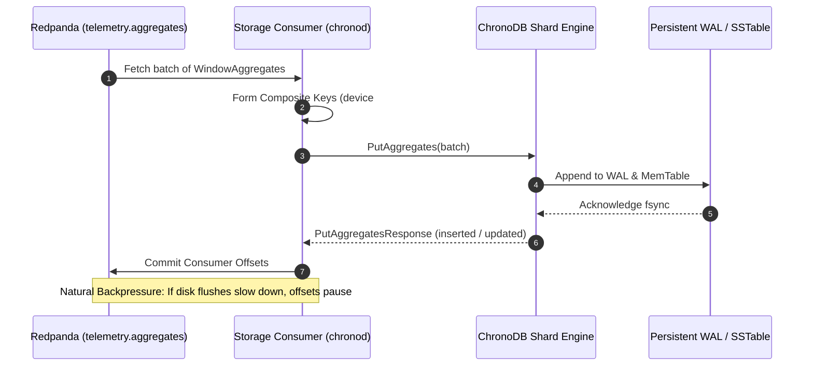
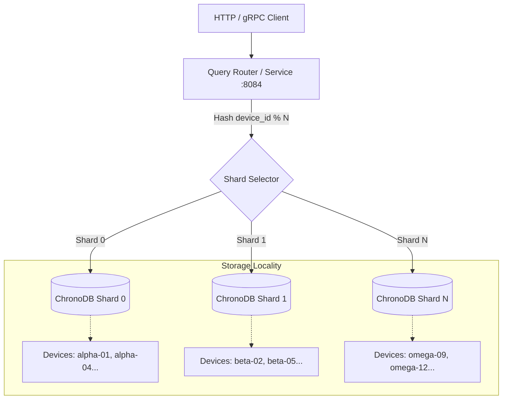

# Phase 1 Data Model: ChronoDB Polyglot Storage Sink & Historical Query Engine

**Feature**: `004-chronodb-storage-query`  
**Date**: 2026-10-23  
**Status**: Complete  

---

## 1. Domain Entities & Schemas

### Entity: `StoredWindowAggregate`
The core persisted telemetry record representing a closed aggregation window.

| Field Name | Type | Description | Verbatim Constraints |
| :--- | :--- | :--- | :--- |
| `device_id` | `string` | Unique device identifier. | Machine or sensor identifier (1 to 128 characters). |
| `metric_name` | `string` | Measured physical quantity. | Standard telemetry metric (e.g. `bearing_temp`). |
| `window_start_ns` | `int64` | Window start boundary in nanoseconds. | Epoch nanoseconds (inclusive). |
| `window_end_ns` | `int64` | Window close boundary in nanoseconds. | Governed strictly by watermark ($window\_start + size$). |
| `count` | `uint64` | Number of observations in interval. | Value $\ge 1$. |
| `sum` | `float64` | Total sum of observations. | Finite IEEE 754 float. |
| `min` | `float64` | Minimum observed value. | Finite IEEE 754 float. |
| `max` | `float64` | Maximum observed value. | Finite IEEE 754 float ($\max \ge \min$). |
| `mean` | `float64` | Average value across observations. | $\text{mean} = \text{sum} / \text{count}$. |

---

### Entity: `CompositeUpsertKey`
Enforces Constitution Principle III (*Idempotent Ingestion & At-Least-Once Delivery*).

```text
Format: {device_id}#{metric_name}#{window_start_ns}#{window_end_ns}
```

- **Uniqueness**: Guarantees that repeating an aggregate write with the exact same window bounds targets the same storage slot.
- **Lexicographical Ordering**: Facilitates efficient range scans over `(device_id, metric_name)` ordered chronologically by `window_start_ns`.

---

### Entity: `RollupBucket`
Synthesized downsampled interval produced dynamically during analytical queries.

| Field Name | Type | Description | Formula |
| :--- | :--- | :--- | :--- |
| `bucket_start_ns` | `int64` | Start of the rollup time step. | $\lfloor window\_start / \text{step} \rfloor \times \text{step}$ |
| `bucket_end_ns` | `int64` | End of the rollup time step. | $bucket\_start + \text{step}$ |
| `count` | `uint64` | Accumulated total observations. | $\sum_i count_i$ |
| `sum` | `float64` | Accumulated total sum. | $\sum_i sum_i$ |
| `min` | `float64` | Minimum across all sub-windows. | $\min_i(min_i)$ |
| `max` | `float64` | Maximum across all sub-windows. | $\max_i(max_i)$ |
| `mean` | `float64` | Mathematically exact weighted average. | $sum / count$ |

---

### Entity: `DeviceCatalogEntry`
Tracks active equipment and recorded metrics in storage metadata.

| Field Name | Type | Description |
| :--- | :--- | :--- |
| `device_id` | `string` | Unique device identifier. |
| `metrics` | `[]string` | Sorted list of unique metric names recorded for this device. |
| `first_seen_ns` | `int64` | Earliest persisted window start timestamp. |
| `last_seen_ns` | `int64` | Latest persisted window end timestamp. |

---

## 2. Ingestion & Storage State Machine



---

## 3. Query Sharding & Single-Shard Affinity


