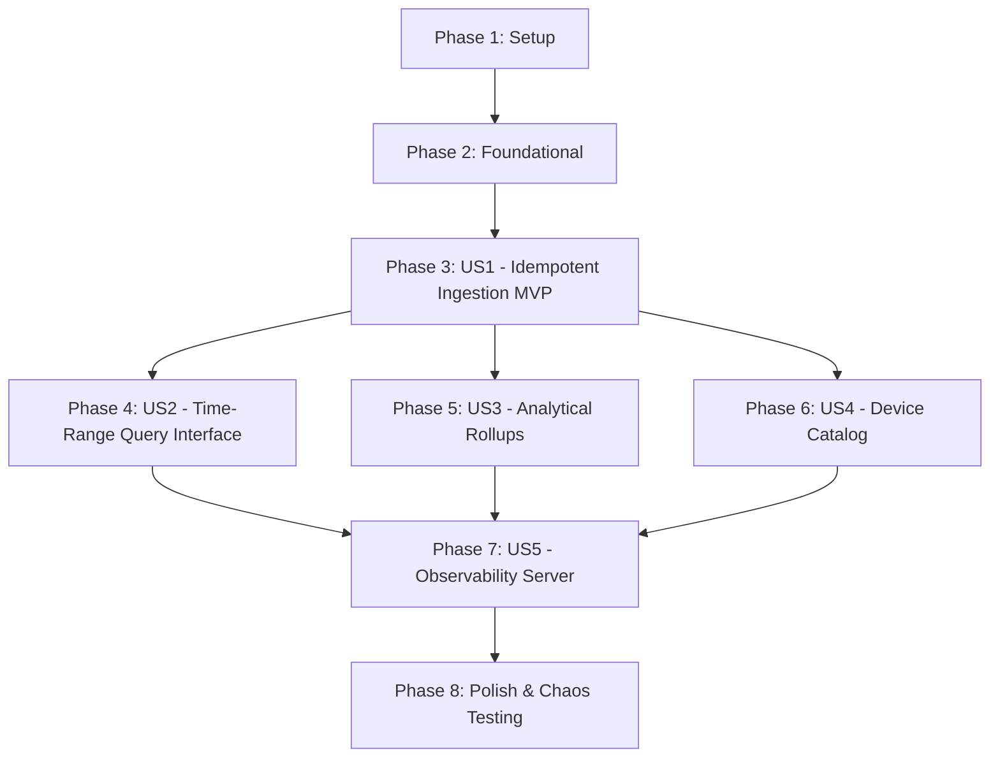

# Tasks: ChronoDB Polyglot Storage Sink & Historical Query Engine

**Feature**: `004-chronodb-storage-query`  
**Plan**: [plan.md](plan.md)  
**Spec**: [spec.md](spec.md)  

---

## Phase 1: Setup (Shared Infrastructure)

**Purpose**: Build automation, protobuf targets, and Docker Compose configurations for storage services.

- [X] T001 [P] Update `Makefile` with targets to compile `chronodb.proto` and build `cmd/chronod` in `Makefile`
- [X] T002 [P] Verify and update `deployments/docker-compose.yml` to expose storage query port `:8084` and ChronoDB gRPC port `:50054` in `deployments/docker-compose.yml`

---

## Phase 2: Foundational (Blocking Prerequisites)

**Purpose**: Protobuf contracts, storage configuration loader, and Prometheus metrics registry.

**⚠️ CRITICAL**: No user story work can begin until this phase is complete.

- [X] T003 Compile Protobuf v3 contract from `specs/004-chronodb-storage-query/contracts/chronodb.proto` into `proto/v1/chronodb.pb.go`
- [X] T004 [P] Implement storage configuration loader (`STORAGE_BROKERS`, `STORAGE_TOPIC_AGGREGATES`, `STORAGE_HTTP_PORT`, `STORAGE_GRPC_PORT`, `STORAGE_SHARDS`, `STORAGE_BATCH_SIZE`, `STORAGE_FLUSH_INTERVAL`) in `internal/storage/config/config.go`
- [X] T005 [P] Implement Prometheus metrics registry (storage writes total, batch write latency histogram, query latency histogram, storage consumer lag gauge, active shards gauge) in `internal/storage/metrics/metrics.go`

**Checkpoint**: Foundation ready — user story implementation can now begin.

---

## Phase 3: User Story 1 - Idempotent Aggregate Ingestion & Polyglot Persistence (Priority: P1) 🎯 MVP

**Goal**: Ingest closed window aggregates from Redpanda topic `telemetry.aggregates`, persist them to ChronoDB across the polyglot boundary sharded by device ID, and guarantee 100% idempotent upserts keyed by `(device_id, metric, window_start, window_end)`.

**Independent Test**: Ingest 100 window aggregates into the sink, replay the same 100 aggregates from Redpanda, and assert that the storage engine contains exactly 100 unique records with identical statistics and no duplicated counts or sums.

### Tests for User Story 1

- [X] T006 [P] [US1] Create unit tests for composite upsert key formatting and in-memory sharded storage engine in `internal/storage/engine/engine_test.go`

### Implementation for User Story 1

- [X] T007 [US1] Implement `ChronoEngine` interface and sharded columnar in-memory storage engine with composite key indexing in `internal/storage/engine/engine.go` and `internal/storage/engine/memory.go`
- [X] T008 [US1] Implement Franz-go consumer loop ingesting `telemetry.aggregates` with batching, natural consumer lag backpressure, and offset commits in `internal/storage/consumer/sink.go`
- [X] T009 [US1] Implement standalone daemon entrypoint in `cmd/chronod/main.go` bootstrapping the consumer group, storage engine, and graceful OS shutdown

**Checkpoint**: User Story 1 is functional and delivers the core idempotent time-series persistence MVP.

---

## Phase 4: User Story 2 - Historical Telemetry Time-Range Query Interface (Priority: P2)

**Goal**: Provide sub-second time-range queries (`device_id`, `metric_name`, `start_time_ns`, `end_time_ns`) returning chronological aggregate intervals with point statistics (min, max, sum, count, mean).

**Independent Test**: Query a 24-hour time range for a device and verify that all matching aggregate intervals are returned in chronological order within 50ms with correct aggregations.

### Tests for User Story 2

- [X] T010 [P] [US2] Create unit tests for time-range query range scanning and parameter validation in `internal/storage/server/server_test.go`

### Implementation for User Story 2

- [X] T011 [US2] Implement ChronoDB gRPC service handling `PutAggregates` and `QueryTimeSeries` across the polyglot boundary in `internal/storage/server/grpc.go`
- [X] T012 [US2] Implement HTTP REST router exposing `GET /api/v1/query` with JSON serialization and validation in `internal/storage/server/http.go`

**Checkpoint**: Historical telemetry can be queried via both gRPC and HTTP interfaces.

---

## Phase 5: User Story 3 - Multi-Resolution Analytical Rollups & Downsampling (Priority: P2)

**Goal**: Dynamically re-aggregate 10-second window aggregates into coarser time buckets (1m, 5m, 1h) by computing exact combined sums, global min/max, total counts, and weighted means.

**Independent Test**: Ingest 360 ten-second window aggregates (1 hour), request a rollup with a 5-minute bucket step, and verify exactly 12 aggregated buckets are returned with mathematically accurate rollups.

### Tests for User Story 3

- [X] T013 [P] [US3] Create unit tests for analytical downsampling rollup mathematics (combined sum, global min/max, weighted mean) in `internal/storage/engine/rollup_test.go`

### Implementation for User Story 3

- [X] T014 [US3] Implement dynamic multi-bucket rollup re-aggregation algorithm in `internal/storage/engine/rollup.go`
- [X] T015 [US3] Expose dynamic rollup endpoints via gRPC (`QueryRollup`) and HTTP REST (`GET /api/v1/query/rollup`) in `internal/storage/server/grpc.go` and `internal/storage/server/http.go`

**Checkpoint**: Long-range historical analytics can be queried with sub-200ms response times.

---

## Phase 6: User Story 4 - Device Discovery & Metric Metadata Catalog (Priority: P3)

**Goal**: Expose catalog endpoints for active device discovery, available metrics, and historical timestamp bounds.

**Independent Test**: Ingest aggregates from 5 distinct devices with 3 metrics each, call the metadata catalog API, and verify all 5 device IDs and their respective metric names are returned with temporal bounds.

### Tests for User Story 4

- [X] T016 [P] [US4] Create unit tests for active device tracking and metric catalog discovery in `internal/storage/engine/catalog_test.go`

### Implementation for User Story 4

- [X] T017 [US4] Implement device catalog metadata tracking across storage shards in `internal/storage/engine/catalog.go`
- [X] T018 [US4] Expose device and metric catalog endpoints via gRPC (`GetDeviceCatalog`) and HTTP REST (`GET /api/v1/devices`) in `internal/storage/server/grpc.go` and `internal/storage/server/http.go`

**Checkpoint**: Edge operators can discover active devices and metrics dynamically.

---

## Phase 7: User Story 5 - Health & Observability Server (Priority: P3)

**Goal**: Expose Prometheus metrics, health checks (`/healthz`), and readiness probes (`/readyz`) on port `:8084`.

**Independent Test**: Scrape `/metrics`, `/healthz`, and `/readyz` on port `:8084` during continuous ingestion and verify status updates.

### Implementation for User Story 5

- [X] T019 [P] [US5] Expose `/healthz`, `/readyz`, and Prometheus `/metrics` on port `:8084` in `internal/storage/server/http.go`

---

## Phase 8: Polish & Chaos Testing

**Purpose**: Idempotency chaos testing, throughput benchmarking, and documentation.

- [X] T020 [P] Implement chaos integration test verifying 100% idempotent storage state and zero double-counting under consumer crash/replay in `tests/integration/idempotent_storage_test.go`
- [X] T021 [P] Implement storage ingestion throughput and historical query latency benchmark in `tests/bench/storage_bench_test.go`
- [X] T022 [P] Update `README.md` and `quickstart.md` with Milestone 004 architecture, verified benchmarks, and run instructions in `README.md`

---

## Dependencies & Execution Order

### Phase Dependencies

### User Story Dependencies

- **US1 (Idempotent Ingestion MVP)**: Sharded storage engine, composite upsert key, Franz-go consumer loop on `telemetry.aggregates`, and `cmd/chronod` (T006–T009).
- **US2 (Time-Range Query)**: ChronoDB gRPC service and HTTP REST endpoint `GET /api/v1/query` (T010–T012).
- **US3 (Analytical Rollups)**: Downsampling re-aggregation engine and `GET /api/v1/query/rollup` (T013–T015).
- **US4 (Device Catalog)**: Metadata catalog tracking and `GET /api/v1/devices` (T016–T018).
- **US5 (Observability Server)**: `/healthz`, `/readyz`, `/metrics` on port `:8084` (T019).
- **Polish (Chaos Test & Benchmark)**: Idempotency replay test and storage throughput benchmark (T020–T022).

### Parallel Opportunities

- **Phase 1**: T001 (Makefile) and T002 (docker-compose) can run in parallel.
- **Phase 2**: T004 (config) and T005 (metrics) can run in parallel.
- **Phase 3**: T006 (unit tests) can run in parallel with foundational setup.
- **Phase 4, 5 & 6**: Once US1 (engine) is complete, US2 (queries), US3 (rollups), and US4 (catalog) can proceed in parallel.
- **Phase 8**: T020 (chaos test), T021 (benchmark), and T022 (docs) can run in parallel.

---

## Implementation Strategy

### MVP First (User Story 1 Only)
1. Complete Phase 1 (Makefile, docker-compose).
2. Complete Phase 2 (Protobuf `chronodb.proto` generation, config, metrics).
3. Complete Phase 3 (US1: in-memory sharded storage engine, composite keys, consumer loop, `cmd/chronod`).
4. **Validate MVP**: Run unit tests in `internal/storage/engine/` verifying composite key uniqueness and 100% idempotent upsert behavior under duplicate ingestion.

### Incremental Delivery
- Step 1: Validate In-Memory Sharded Idempotent Aggregate Storage (US1).
- Step 2: Validate Time-Range Query APIs via gRPC & REST (US2).
- Step 3: Validate Dynamic Multi-Bucket Downsampling Rollups (US3).
- Step 4: Validate Device & Metric Metadata Catalog (US4).
- Step 5: Validate Observability Endpoints (`/healthz`, `/readyz`, `/metrics` on `:8084`) (US5).
- Step 6: Execute Idempotency Replay Chaos Integration Test & Benchmarks (Polish).
