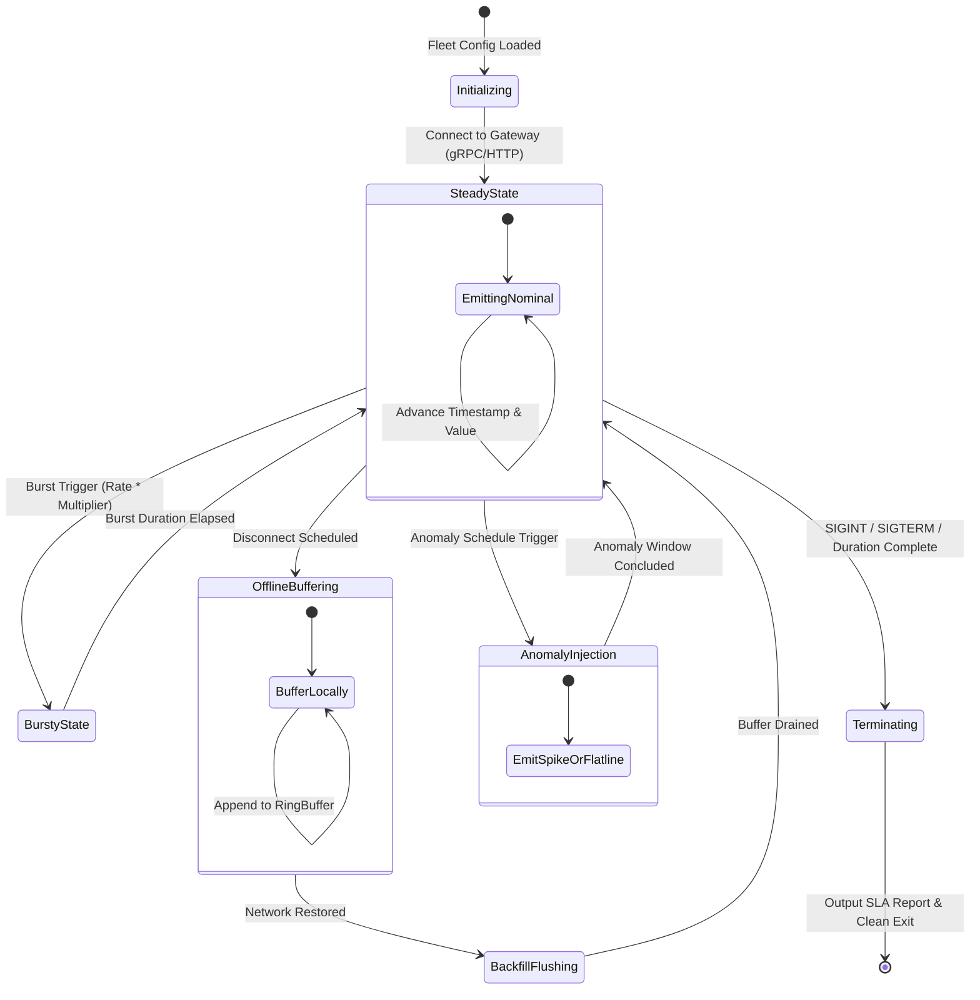

# Data Model: Milestone 005 — Fleet Load Simulator & Chaos Harness

**Feature**: `005-fleet-load-simulator`  
**Date**: 2026-10-24  
**Status**: Completed  

---

## Core Entities & Schemas

### 1. `DeviceTopology` & `DeviceState`

Represents an individual simulated IoT sensor node within the virtual fleet.

| Field | Type | Description | Validation Rules |
| :--- | :--- | :--- | :--- |
| `DeviceID` | `string` | Unique device identifier | Non-empty, format: `[archetype]-[00000..99999]`, length $\le 128$ |
| `Archetype` | `DeviceArchetype` | Physical archetype (turbine, motor, pump, generator) | Must be valid enum value |
| `Metrics` | `[]MetricState` | List of simulated physical sensor channels | At least 1 metric per device |
| `LastTimestampNs` | `int64` | Timestamp of most recently generated reading | Monotonically non-decreasing in steady-state |
| `IsOffline` | `bool` | Flag indicating active network disconnect | Boolean |
| `OfflineBuffer` | `[]*TelemetryReading` | Local buffer holding unsent readings during offline state | Bounded capacity $\le 5,000$ readings |
| `ActiveAnomaly` | `*AnomalyState` | Active chaotic state transition (if injected) | Optional, nil during nominal operation |

---

### 2. `MetricState`

Models the physical signal generator for a specific metric channel on a device.

| Field | Type | Description | Example / Bounds |
| :--- | :--- | :--- | :--- |
| `MetricName` | `string` | Telemetry metric key | `vibration`, `bearing_temp`, `rotor_rpm`, `power_mw` |
| `Unit` | `string` | Physical engineering unit | `mm/s`, `celsius`, `rpm`, `mw`, `psi` |
| `BaseValue` | `float64` | Central nominal operating value | $50.0$ |
| `Amplitude` | `float64` | Sinusoidal periodic oscillation amplitude | $2.5$ |
| `Frequency` | `float64` | Oscillation frequency in Hz | $0.05$ |
| `NoiseSigma` | `float64` | Standard deviation of Gaussian white noise | $0.25$ |
| `CurrentPhase` | `float64` | Current sinusoidal angular phase $\phi$ | $[0, 2\pi)$ |
| `DriftRate` | `float64` | Slow linear calibration drift per reading | Typically $0.0$ |

---

### 3. `TrafficProfile`

Defines the dynamic behavior and chaos schedule for the load generation session.

| Field | Type | Default | Description |
| :--- | :--- | :--- | :--- |
| `Type` | `ProfileType` | `PROFILE_STEADY_STATE` | `steady_state`, `bursty`, `offline_recovery`, `anomaly_chaos` |
| `TargetRate` | `int` | `50000` | Baseline generation rate (events/sec) |
| `BurstMultiplier` | `float64` | `3.0` | Peak throughput rate multiplier ($1.5 \le M \le 5.0$) |
| `BurstDuration` | `time.Duration` | `15s` | Duration of burst traffic surge |
| `BurstInterval` | `time.Duration` | `60s` | Period between recurring bursts |
| `OfflineDevicePct` | `float64` | `0.05` | Fraction of devices that undergo network disconnect ($5\%$) |
| `OfflineDuration` | `time.Duration` | `30s` | Duration of edge buffer accumulation before backfill |
| `AnomalyPct` | `float64` | `0.02` | Percentage of readings injected with deliberate anomalies ($2\%$) |
| `AnomalyMode` | `AnomalyMode` | `ANOMALY_STEP_SPIKE` | `step_spike`, `variance_flatline`, `calibration_drift` |

---

### 4. `SimulationMetrics` & `SLAComplianceReport`

Tracks real-time telemetry generation performance and end-to-end SLA compliance.

| Field | Type | Description | SLA Requirement |
| :--- | :--- | :--- | :--- |
| `TargetRate` | `int` | Requested events/sec rate | Target $\ge 50,000\text{ events/sec}$ |
| `AchievedRate` | `float64` | Measured sustained events/sec rate | MUST be $\ge 0.95 \times \text{TargetRate}$ |
| `TotalSent` | `int64` | Total successfully acknowledged telemetry readings | Non-negative integer |
| `TotalFailed` | `int64` | Total rejected or dropped readings | Error rate $< 0.1\%$ |
| `ElapsedSeconds` | `float64` | Total test execution duration | $\ge 1.0\text{s}$ |
| `CanarySamples` | `int` | Number of end-to-end latency probes sent | $\ge 5$ probes per minute |
| `CanaryP95LatencyMs` | `float64` | 95th percentile window-close-to-query latency | MUST be $< 2,000\text{ ms}$ (Constitution Target) |
| `SLACompliant` | `bool` | Overall verdict: `true` if all SLA targets passed | Boolean |
| `Violations` | `[]string` | Detailed list of any violated performance gates | Empty if compliant |

---

## State Transitions: Device Lifecycle & Chaos

