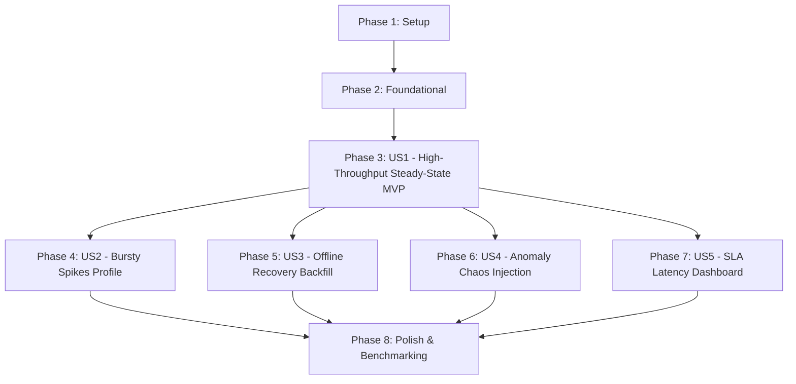

# Tasks: Milestone 005 — High-Throughput Device Fleet Load Simulator & Chaos Harness

**Feature**: `005-fleet-load-simulator`  
**Plan**: [plan.md](plan.md)  
**Spec**: [spec.md](spec.md)  

---

## Phase 1: Setup (Shared Infrastructure)

**Purpose**: Build automation, directory scaffolding, and Makefile targets for simulator binaries.

- [ ] T001 Update `Makefile` with targets to compile `cmd/simulator` into `bin/simulator` and add `sim` run target in `Makefile`
- [ ] T002 [P] Create directory structure for simulator entrypoint and internal modules in `cmd/simulator/` and `internal/simulator/`

---

## Phase 2: Foundational (Blocking Prerequisites)

**Purpose**: Core configuration loader, atomic metrics tracker, signal generator, and rate limiter.

**⚠️ CRITICAL**: No user story work can begin until this phase is complete.

- [ ] T003 [P] Implement simulator configuration loader supporting CLI flags and environment variables (`SIM_TARGET_RATE`, `SIM_NUM_DEVICES`, `SIM_DURATION`, `SIM_TRANSPORT`, `SIM_PROFILE`) in `internal/simulator/config/config.go`
- [ ] T004 [P] Implement lock-free atomic throughput, latency, and error counter in `internal/simulator/metrics/tracker.go`
- [ ] T005 [P] Implement physical sensor signal generator (sinusoidal + Gaussian white noise + baseline drift) in `internal/simulator/signal/signal.go`
- [ ] T006 [P] Implement high-resolution token bucket rate limiter and micro-batch pacing coordinator in `internal/simulator/pacing/limiter.go`

**Checkpoint**: Foundation ready — user story implementation can now begin.

---

## Phase 3: User Story 1 - Configurable Device Fleet Topology & High-Throughput Steady-State Generation (Priority: P1) 🎯 MVP

**Goal**: Instantiate a virtual fleet of $10,000+$ devices emitting realistic multi-metric telemetry sustaining $\ge 50,000\text{ events/sec}$ over gRPC streaming (`:50051`) and HTTP batching (`:8080`).

**Independent Test**: Run simulator with 1,000 devices driving 50,000 events/sec for 30 seconds over gRPC; assert $\ge 50,000\text{ events/sec}$ achieved with zero dropped packets.

### Tests for User Story 1

- [ ] T007 [P] [US1] Create unit tests for virtual device topology creation and worker fleet partitioning in `internal/simulator/fleet/fleet_test.go`
- [ ] T008 [P] [US1] Create unit tests for physical signal generation and boundary clamping in `internal/simulator/signal/signal_test.go`
- [ ] T009 [P] [US1] Create unit tests for token bucket rate limiter accuracy and micro-batch pacing in `internal/simulator/pacing/limiter_test.go`

### Implementation for User Story 1

- [ ] T010 [US1] Implement industrial device archetypes (`turbine-XXXX`, `motor-XXXX`, `pump-XXXX`, `generator-XXXX`) with realistic metric names and physical units in `internal/simulator/fleet/archetype.go`
- [ ] T011 [US1] Implement virtual device topology manager and deterministic worker partitioner in `internal/simulator/fleet/fleet.go`
- [ ] T012 [US1] Implement transport client interface and client-side gRPC streaming sender (`:50051`) and HTTP batch sender (`:8080`) in `internal/simulator/transport/client.go`, `internal/simulator/transport/grpc.go`, and `internal/simulator/transport/http.go`
- [ ] T013 [US1] Implement standalone simulator CLI main entrypoint bootstrapping fleet, workers, and transports with OS signal handling in `cmd/simulator/main.go`

**Checkpoint**: User Story 1 is functional and delivers the core high-throughput steady-state generation MVP.

---

## Phase 4: User Story 2 - Bursty Spikes & Backpressure Traffic Profile (Priority: P2)

**Goal**: Inject sudden $3\times$ to $5\times$ surge load bursts for 10–30 seconds to test broker queue absorption, consumer lag bounding, and backpressure propagation without event drops.

**Independent Test**: Inject a 10-second burst at $3\times$ baseline volume; verify pipeline absorbs surge and rate recovers gracefully.

### Tests for User Story 2

- [ ] T014 [P] [US2] Create unit tests for burst multiplier transitions and burst duration timers in `internal/simulator/chaos/burst_test.go`

### Implementation for User Story 2

- [ ] T015 [US2] Implement burst traffic schedule and dynamic rate scaling controller in `internal/simulator/chaos/burst.go`
- [ ] T016 [US2] Wire burst profile controls into worker pacing loop and `cmd/simulator/main.go`

**Checkpoint**: Bursty traffic profile operational and validated.

---

## Phase 5: User Story 3 - Offline Network Disconnect & Out-of-Order Recovery Backfills (Priority: P2)

**Goal**: Simulate fleet network disconnects where a fraction of devices buffer telemetry locally for 30–60s and dump out-of-order backfill upon reconnection, verifying event-time watermarking and late-data dead-letter routing.

**Independent Test**: Disconnect 10% of devices for 20s, reconnect with burst backfill; verify late events route to `telemetry.late` without mutating closed ChronoDB aggregates.

### Tests for User Story 3

- [ ] T017 [P] [US3] Create unit tests for per-device offline ring buffer accumulation and burst backfill replay in `internal/simulator/chaos/offline_test.go`

### Implementation for User Story 3

- [ ] T018 [US3] Implement offline network disconnection state machine and backfill replay flusher in `internal/simulator/chaos/offline.go`
- [ ] T019 [US3] Wire offline recovery profile into fleet worker loop and `cmd/simulator/main.go`

**Checkpoint**: Offline recovery chaos operational and validated.

---

## Phase 6: User Story 4 - Deliberate Sensor Anomaly & Failure Chaos Injection (Priority: P3)

**Goal**: Inject deliberate step spikes ($z \ge 5.0$), sensor drifts, and zero-variance flatlines into targeted devices to verify real-time $k$-sigma anomaly detection and decoupled alerting.

**Independent Test**: Inject step spikes ($z \ge 5.0$) on 2% of fleet; verify downstream alert events are generated and processed by `alertd`.

### Tests for User Story 4

- [ ] T020 [P] [US4] Create unit tests for step spikes, variance flatlines, and calibration drifts in `internal/simulator/chaos/anomaly_test.go`

### Implementation for User Story 4

- [ ] T021 [US4] Implement anomaly injection state machines (spikes, flatlines, drifts) in `internal/simulator/chaos/anomaly.go`
- [ ] T022 [US4] Wire anomaly injection profile into fleet telemetry generation and `cmd/simulator/main.go`

**Checkpoint**: Anomaly chaos injection operational and validated.

---

## Phase 7: User Story 5 - Real-Time Ingestion SLA & Latency Telemetry Dashboard (Priority: P3)

**Goal**: Render a live terminal progress dashboard, sample end-to-end canary latencies against ChronoDB (`:8084`), and produce JSON SLA compliance reports.

**Independent Test**: Run simulation with `--json` and `--canary-interval 5s`; verify JSON report conformity with schema and p95 latency evaluation.

### Tests for User Story 5

- [ ] T023 [P] [US5] Create unit tests for JSON SLA report generation against `contracts/report-schema.json` in `internal/simulator/report/report_test.go`

### Implementation for User Story 5

- [ ] T024 [US5] Implement synthetic canary probe emitter and ChronoDB query latency poller in `internal/simulator/canary/probe.go`
- [ ] T025 [US5] Implement live terminal progress renderer and JSON SLA report generator in `internal/simulator/report/summary.go`
- [ ] T026 [US5] Wire canary latency tracking and SLA reporting into `cmd/simulator/main.go`

**Checkpoint**: Live progress dashboard and automated JSON SLA reporting operational.

---

## Phase 8: Polish & High-Throughput Benchmarking

**Purpose**: Throughput benchmarking, documentation updates, and CI integration.

- [ ] T027 [P] Implement simulator client-side throughput benchmark measuring sustained $> 100,000$ events/sec generation in `tests/bench/simulator_bench_test.go`
- [ ] T028 [P] Update `README.md` and `specs/005-fleet-load-simulator/quickstart.md` with simulator CLI documentation, verified benchmarks, and operational load testing guide

---

## Dependencies & Execution Order

### Phase Dependencies

### User Story Dependencies

- **US1 (Steady-State MVP)**: Virtual device topology, archetypes, gRPC streaming sender, HTTP batch sender, CLI entrypoint (T007–T013).
- **US2 (Bursty Spikes)**: Burst schedule and multiplier scaling (T014–T016).
- **US3 (Offline Backfills)**: Local ring buffer and backfill replay flusher (T017–T019).
- **US4 (Anomaly Chaos)**: Step spikes, flatlines, drift state machines (T020–T022).
- **US5 (SLA Dashboard & Canary)**: Live progress dashboard, canary poller, JSON report (T023–T026).
- **Polish**: High-throughput driver benchmark and documentation (T027–T028).

### Parallel Opportunities

- **Phase 1**: T001 (Makefile) and T002 (directories) can run in parallel.
- **Phase 2**: T003 (config), T004 (metrics), T005 (signal), and T006 (limiter) can run in parallel.
- **Phase 3**: T007, T008, and T009 (unit tests) can run in parallel.
- **Phase 4, 5, 6, 7**: Once US1 (fleet engine) is complete, US2 (burst), US3 (offline), US4 (anomaly), and US5 (dashboard) can proceed in parallel.
- **Phase 8**: T027 (benchmark) and T028 (docs) can run in parallel.

---

## Implementation Strategy

### MVP First (User Story 1 Only)

1. Complete Phase 1 (Makefile, directories).
2. Complete Phase 2 (Config, metrics, signal generator, rate limiter).
3. Complete Phase 3 (US1: virtual fleet topology, gRPC streaming, HTTP batching, `cmd/simulator`).
4. **Validate MVP**: Run `bin/simulator --rate 50000 --devices 1000 --duration 15s` verifying sustained $\ge 50,000$ events/sec with zero packet drops.

### Incremental Delivery

- Step 1: Validate High-Throughput Steady-State Generation MVP (US1).
- Step 2: Validate Bursty Spikes & Backpressure Propagation (US2).
- Step 3: Validate Offline Disconnect & Monotonic Watermark Backfill (US3).
- Step 4: Validate Deliberate Anomaly Chaos & Alert Verification (US4).
- Step 5: Validate Live Progress Dashboard & End-to-End Canary Latency (US5).
- Step 6: Execute Full Fleet Benchmark & Documentation (Polish).
