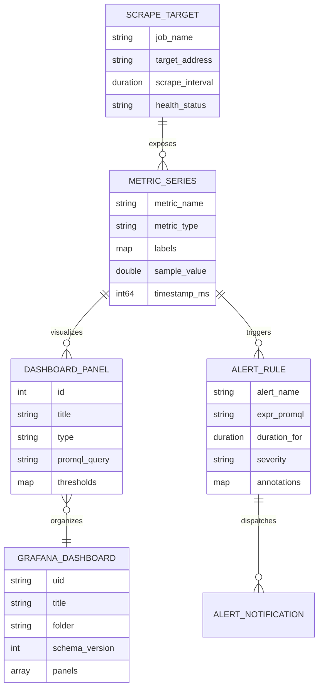

# Data Model: Milestone 006 — Unified Multi-Service Observability & Grafana Dashboards

**Feature**: `006-unified-observability-dashboards`  
**Date**: 2026-10-26  
**Status**: Completed  

---

## 1. Domain Entities & Telemetry Schemas



---

## 2. Entity Definitions

### 2.1 ScrapeTarget
Represents an HTTP endpoint exposed by a platform subsystem delivering metrics in Prometheus text exposition format.

| Field | Type | Description | Example |
| :--- | :--- | :--- | :--- |
| `job_name` | string | Logical identifier for the scraping job | `"pulse-gateway"`, `"pulse-processor"` |
| `targets` | list[string] | Host:Port addresses scraped | `["gateway:8080"]`, `["host.docker.internal:8080"]` |
| `metrics_path` | string | HTTP path providing metrics | `"/metrics"`, `"/public_metrics"` |
| `scrape_interval` | duration | Polling frequency | `"5s"` |
| `scrape_timeout` | duration | Maximum time allowed per scrape | `"3s"` |

---

### 2.2 MetricSeries
An individual time-series measurement identified by name and label set.

| Type | Prometheus Keyword | Semantics | Examples |
| :--- | :--- | :--- | :--- |
| **Counter** | `counter` | Monotonically increasing cumulative value | `pulse_ingest_readings_total`, `pulse_processor_events_total` |
| **Gauge** | `gauge` | Instantaneous numerical value (can rise/fall) | `pulse_processor_open_windows`, `pulse_alert_active_incidents` |
| **Histogram** | `histogram` | Samples observed into configurable buckets | `pulse_storage_query_duration_seconds_bucket` |

---

### 2.3 AlertRule
A condition evaluated on a periodic cycle against stored PromQL expressions.

| Field | Type | Description | Example |
| :--- | :--- | :--- | :--- |
| `alert` | string | Unique alert rule identifier | `"CriticalIngestionErrorRate"` |
| `expr` | string | PromQL boolean evaluation expression | `rate(pulse_ingest_errors_total[1m]) > 10` |
| `for` | duration | Minimum persistence duration before firing | `"1m"`, `"30s"` |
| `labels.severity` | string | Operational priority | `"critical"`, `"warning"`, `"info"` |
| `annotations.summary`| string | Human-readable alert summary | `"Ingestion error rate exceeds 0.1% SLA"` |
| `annotations.runbook`| string | Remediation guidance | `"Inspect gateway socket drops and malformed JSON payloads"` |

---

### 2.4 GrafanaDashboard & DashboardPanel
Declarative configuration modeling dashboards and visual panels.

| Panel Type | Visualization Purpose | Example Metric / PromQL |
| :--- | :--- | :--- |
| **Stat / Gauge** | Single scalar with SLA threshold color mapping | Instantaneous throughput (`50,420 ev/s`), Canary p95 (`1.42s`) |
| **Time Series** | Historical trend line over time | Ingestion rate over 1h, Watermark vs Wall-clock progression |
| **Bar Gauge** | Categorical distribution | Anomaly severity distribution (`INFO`, `WARNING`, `CRITICAL`) |
| **Heatmap** | Multi-dimensional distribution over time | Historical query latency percentiles |
| **State Timeline**| Discrete state transitions over time | Circuit breaker state (`0=CLOSED`, `1=HALF_OPEN`, `2=OPEN`) |
| **Stacked Area** | Multi-partition contribution to total | Per-partition consumer lag across all 12 Redpanda partitions |

---

## 3. Data Flow Architecture

```text
[Gateway :8080]    [Processor :8081]    [Alertd :8083]    [Chronod :8084]    [Redpanda :9644]
       │                  │                   │                  │                  │
       └──────────────────┴─────────┬─────────┴──────────────────┴──────────────────┘
                                    │
                                    ▼ (Scrapes every 5s)
                          [Prometheus :9090]
                                    │
                     ┌──────────────┴──────────────┐
                     ▼ (Evaluates rules)           ▼ (Queries PromQL)
           [Alertmanager :9093]           [Grafana :3000]
                     │                             │
                     ▼ (Webhooks/Notifications)    ▼ (Interactive Monitoring)
              Platform Team                  Executive & Ops Teams
```
