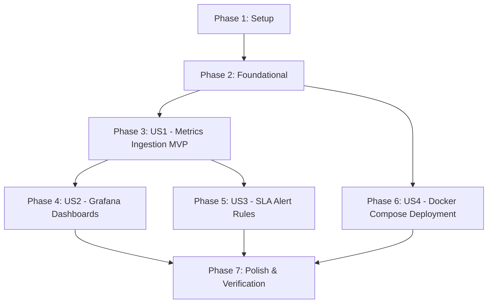

# Tasks: Milestone 006 — Unified Multi-Service Observability & Executive Grafana Dashboards

**Feature**: `006-unified-observability-dashboards`  
**Plan**: [plan.md](plan.md)  
**Spec**: [spec.md](spec.md)  

---

## Phase 1: Setup (Shared Infrastructure)

**Purpose**: Create configuration scaffolding for Prometheus, Grafana, and Alertmanager.

- [ ] T001 [P] Create directory structure for Prometheus, Grafana, and Alertmanager configurations in `deployments/prometheus/`, `deployments/alertmanager/`, and `deployments/grafana/provisioning/{datasources,dashboards}/`
- [ ] T002 [P] Configure Grafana declarative datasource provisioning pointing to Prometheus in `deployments/grafana/provisioning/datasources/prometheus.yaml`
- [ ] T003 [P] Configure Grafana declarative dashboard provider in `deployments/grafana/provisioning/dashboards/dashboards.yaml`

---

## Phase 2: Foundational (Blocking Prerequisites)

**Purpose**: Centralized metric collection configuration and multi-container Docker Compose orchestration.

**⚠️ CRITICAL**: No user story work can begin until this phase is complete.

- [ ] T004 [P] Implement unified Prometheus scrape configuration with 5-second polling interval and target endpoints for Gateway (`:8080`), Processor (`:8081`), Alert Dispatcher (`:8083`), ChronoDB (`:8084`), and Redpanda (`:9644`) in `deployments/prometheus/prometheus.yml`
- [ ] T005 [P] Configure Alertmanager routing, grouping intervals, and default webhook receivers in `deployments/alertmanager/alertmanager.yml`
- [ ] T006 Update `deployments/docker-compose.yml` to orchestrate `prometheus`, `grafana`, `alertmanager`, and `redpanda` containers on `pulse-network` with persistent volume mounts and `extra_hosts` for host connectivity

**Checkpoint**: Core observability infrastructure is configured and ready for user story implementations.

---

## Phase 3: User Story 1 - Centralized Multi-Service Metrics Ingestion & Platform Prometheus Scraping (Priority: P1) 🎯 MVP

**Goal**: Discover and scrape all 5 platform subsystems (Gateway, Processor, Alertd, ChronoDB, Redpanda) every 5 seconds with zero persistent scrape failures.

**Independent Test**: Start platform services and Prometheus; execute `curl -s http://localhost:9090/api/v1/targets | jq` and verify that all 5 scrape targets report `health: "up"` with active metric ingestion.

### Tests for User Story 1

- [ ] T007 [P] [US1] Create integration test verifying all 5 service scrape targets register `health: "up"` in `tests/integration/observability_test.go`

### Implementation for User Story 1

- [ ] T008 [US1] Verify and standardize metric names and Prometheus formatting across Gateway, Processor, Alertd, and ChronoDB endpoints conforming to `specs/006-unified-observability-dashboards/contracts/prometheus-metrics.md`
- [ ] T009 [US1] Verify Redpanda broker public Prometheus metrics endpoint (`:9644/public_metrics`) and partition offset discovery in `deployments/prometheus/prometheus.yml`

**Checkpoint**: User Story 1 is functional and provides the centralized metric collection foundation.

---

## Phase 4: User Story 2 - Executive & Subsystem Grafana Dashboards (Priority: P1)

**Goal**: Auto-provision 5 specialized Grafana dashboards loaded declaratively upon container startup, providing deep real-time operational insights without manual UI setup.

**Independent Test**: Launch Grafana at `http://localhost:3000` and verify all 5 dashboards load cleanly, connect to Prometheus, and render real-time charts during simulator load execution.

### Tests for User Story 2

- [ ] T010 [P] [US2] Create unit test validating Grafana dashboard JSON schema integrity in `tests/integration/dashboards_test.go`

### Implementation for User Story 2

- [ ] T011 [P] [US2] Build Dashboard A: **Pulse Executive Pipeline Overview** (`pulse-executive-overview`) with total throughput stat, canary p95 gauge ($< 2.0$s SLA), ingestion error rate, active incidents, and end-to-end volume in `deployments/grafana/dashboards/executive_overview.json`
- [ ] T012 [P] [US2] Build Dashboard B: **Ingestion Gateway & Redpanda Partition Lag** (`pulse-ingest-broker-lag`) with gRPC vs HTTP protocol rates, gateway latency heatmap, stacked 12-partition consumer lag, and rejections in `deployments/grafana/dashboards/ingest_broker_lag.json`
- [ ] T013 [P] [US2] Build Dashboard C: **Stream Processor & Watermarking Health** (`pulse-stream-processor`) with watermark vs wall-clock progression, per-partition watermark lag (ms), open window min-heap depth, and late-data drop rate in `deployments/grafana/dashboards/stream_processor.json`
- [ ] T014 [P] [US2] Build Dashboard D: **Anomaly Detection & Decoupled Alerting** (`pulse-anomaly-alerts`) with $k$-sigma anomaly rates by severity (`INFO`, `WARNING`, `CRITICAL`), circuit breaker state timeline, cooldown suppression rate, and webhook dispatch latency percentiles in `deployments/grafana/dashboards/anomaly_alerts.json`
- [ ] T015 [P] [US2] Build Dashboard E: **ChronoDB Storage & Analytical Query Engine** (`pulse-chronodb-storage`) with storage write rates, batch upsert latency percentiles, historical range query heatmap, dynamic rollup downsampling execution times, and 16-shard balance in `deployments/grafana/dashboards/chronodb_storage.json`

**Checkpoint**: All 5 Grafana dashboards operational and verified against active workloads.

---

## Phase 5: User Story 3 - Automated SLA Alerting & Notification Rules via Alertmanager (Priority: P2)

**Goal**: Enforce platform SLA gates by defining Prometheus alerting rules that trigger within 15 seconds of error rate spikes, consumer lag accumulation, watermark stalls, or circuit breaker trips.

**Independent Test**: Query Prometheus rules at `http://localhost:9090/api/v1/rules`; simulate an SLA violation (e.g. consumer lag or circuit breaker trip) and verify Alertmanager transitions the alert to `firing` and dispatches to the receiver.

### Tests for User Story 3

- [ ] T016 [P] [US3] Create integration tests verifying Prometheus alert rule syntax and threshold evaluation in `tests/integration/alert_rules_test.go`

### Implementation for User Story 3

- [ ] T017 [US3] Implement Prometheus alert rules enforcing Gateway error rate SLA ($> 0.10\%$), consumer group lag SLA ($> 250,000$ events / $> 5\text{s}$), and watermark stagnation ($> 15\text{s}$) in `deployments/prometheus/alert_rules.yml`
- [ ] T018 [US3] Implement Prometheus alert rules enforcing Alertmanager notifications for Alertd circuit breaker `OPEN`, Canary latency SLA breach ($> 2000\text{ms}$), and ChronoDB query latency degradation ($> 5\text{ms}$) in `deployments/prometheus/alert_rules.yml`
- [ ] T019 [US3] Wire Prometheus alerting configuration to link `alert_rules.yml` and connect to Alertmanager (`alertmanager:9093`) in `deployments/prometheus/prometheus.yml`

**Checkpoint**: Automated SLA alerting is operational and verified.

---

## Phase 6: User Story 4 - Single-Command Compose Deployment & Local Observability Harness (Priority: P2)

**Goal**: Deliver a seamless single-command workflow to start and stop the entire observability infrastructure with persistent volumes and health checks.

**Independent Test**: Run `docker compose -f deployments/docker-compose.yml up -d`; verify all 4 containers start healthy and persist dashboard data across container restarts.

### Implementation for User Story 4

- [ ] T020 [US4] Update `Makefile` with targets `obs-up`, `obs-down`, `dashboards`, and integrate observability health checks into `make up` and `make e2e` in `Makefile`
- [ ] T021 [US4] Verify seamless container bootstrap, network bridge reachability, and persistent storage mounts across Docker Compose in `deployments/docker-compose.yml`

**Checkpoint**: Single-command infrastructure deployment operational.

---

## Phase 7: Polish & End-to-End Observability Verification

**Purpose**: Multi-service integration testing, automated load verification, and documentation.

- [ ] T022 [P] Implement end-to-end load testing and Prometheus metrics validation script running simulator load against the full observability stack in `scripts/verify_observability.sh`
- [ ] T023 [P] Update `README.md` and `specs/006-unified-observability-dashboards/quickstart.md` with Grafana dashboard screenshots, PromQL query references, and operational monitoring guides

---

## Dependencies & Execution Order

### Phase Dependencies

### User Story Dependencies

- **US1 (Metrics Ingestion MVP)**: Prometheus scrape configuration and multi-service target validation (T007–T009).
- **US2 (Grafana Dashboards)**: Depends on US1; requires metrics to be active to render panels (T010–T015).
- **US3 (SLA Alert Rules)**: Depends on US1; evaluates PromQL expressions over scraped metrics (T016–T019).
- **US4 (Compose Deployment)**: Can proceed alongside US1/US2/US3; coordinates container networking (T020–T021).
- **Polish**: Full pipeline load testing and documentation (T022–T023).

---

## Parallel Opportunities

- **Phase 1**: T001, T002, and T003 can run in parallel (different files in `deployments/`).
- **Phase 2**: T004 and T005 can run in parallel (`prometheus.yml` vs `alertmanager.yml`).
- **Phase 4 (Dashboards)**: All 5 dashboard JSON generation tasks (T011, T012, T013, T014, T015) can execute in parallel.
- **Phase 5 (Alerts)**: T016 (test) can run in parallel with rule definitions.
- **Phase 7**: T022 (script) and T023 (documentation) can run in parallel.

---

## Implementation Strategy

### MVP First (User Story 1 Only)

1. Complete Phase 1: Setup (`deployments/` scaffolding, Grafana provisioning config).
2. Complete Phase 2: Foundational (`prometheus.yml`, `alertmanager.yml`, `docker-compose.yml`).
3. Complete Phase 3: User Story 1 (Prometheus scraping all 5 subsystems).
4. **Validate MVP**: Query `http://localhost:9090/api/v1/targets` and confirm all 5 endpoints are `UP`.

### Incremental Delivery

- Step 1: Validate Metrics Collection MVP (US1).
- Step 2: Validate 5 Declarative Grafana Dashboards under active load (US2).
- Step 3: Validate SLA Alert Rules and Alertmanager routing (US3).
- Step 4: Validate Single-Command Compose Workflow (`make up` / `make obs-up`) (US4).
- Step 5: Execute Automated Load Verification & Polish (Phase 7).
