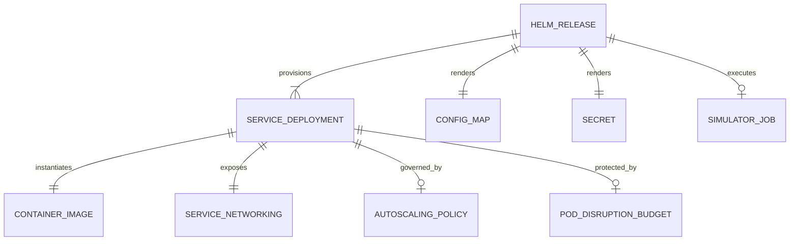

# Data Model & Configuration Schema: Milestone 007 — Production Container Packaging & Kubernetes Deployment

**Feature**: `007-k8s-production-deployment`  
**Date**: 2026-10-27  
**Status**: Completed  

---

## 1. Conceptual Entities & Relationships



---

## 2. Entity Definitions

### 2.1 ContainerImage
Represents the OCI container build specification for each microservice.

| Field | Type | Description |
| :--- | :--- | :--- |
| `service_name` | String | Microservice name (`gateway`, `processor`, `alertd`, `chronod`, `simulator`) |
| `dockerfile_path` | String | Relative path to Dockerfile (e.g. `deployments/docker/Dockerfile.<service>` or unified multi-target `Dockerfile`) |
| `builder_image` | String | `golang:1.23-alpine` |
| `runtime_image` | String | `gcr.io/distroless/static-debian12:nonroot` |
| `binary_path` | String | Compiled static binary path (`/usr/local/bin/<service>`) |
| `run_user` | String / Int | `nonroot` (`UID:GID 65532:65532`) |
| `exposed_ports` | Array[Int] | Container ports exposed (`8080`, `50051`, `8081`, `8083`, `8084`, `50054`) |
| `read_only_fs` | Boolean | True (requires `/tmp` emptyDir mount) |

---

### 2.2 HelmValues Configuration Schema
The hierarchical configuration contract supplied via `values.yaml`.

```yaml
global:
  imageRegistry: "docker.io/losercreates"
  imagePullPolicy: "IfNotPresent"
  tag: "latest"
  redpanda:
    brokers: "pulse-redpanda:9092"
    topics:
      raw: "telemetry.raw"
      aggregates: "telemetry.aggregates"
      late: "telemetry.late"
      alerts: "telemetry.alerts"
      deadletter: "telemetry.alerts.deadletter"

gateway:
  replicaCount: 2
  image:
    repository: "pulse-gateway"
  service:
    type: ClusterIP
    httpPort: 8080
    grpcPort: 50051
  resources:
    requests: { cpu: 100m, memory: 128Mi }
    limits: { cpu: 1000m, memory: 512Mi }
  autoscaling:
    enabled: true
    minReplicas: 2
    maxReplicas: 10
    targetCPUUtilizationPercentage: 75

processor:
  replicaCount: 2
  image:
    repository: "pulse-processor"
  service:
    type: ClusterIP
    httpPort: 8081
  resources:
    requests: { cpu: 200m, memory: 256Mi }
    limits: { cpu: 2000m, memory: 1Gi }
  autoscaling:
    enabled: true
    minReplicas: 1
    maxReplicas: 12  # Capped at Redpanda 12-partition ceiling
    targetCPUUtilizationPercentage: 75

alertd:
  replicaCount: 1
  image:
    repository: "pulse-alertd"
  service:
    type: ClusterIP
    httpPort: 8083
  resources:
    requests: { cpu: 50m, memory: 64Mi }
    limits: { cpu: 500m, memory: 256Mi }
  webhookURL: "http://host.docker.internal:8083/api/v1/alerts/webhook"

chronod:
  replicaCount: 1
  image:
    repository: "pulse-chronod"
  service:
    type: ClusterIP
    httpPort: 8084
    grpcPort: 50054
  resources:
    requests: { cpu: 200m, memory: 256Mi }
    limits: { cpu: 2000m, memory: 2Gi }

simulator:
  enabled: false
  image:
    repository: "pulse-simulator"
  targetRate: 25000
  devices: 500
  duration: "60s"
  profile: "mixed"
  transport: "grpc"
```

---

### 2.3 ServiceDeployment
Represents a Kubernetes `apps/v1` `Deployment`.

- **Labels**: `app.kubernetes.io/name`, `app.kubernetes.io/instance`, `app.kubernetes.io/component`.
- **Termination Grace Period**: `30s`.
- **Security Context**:
  - `runAsNonRoot: true`
  - `runAsUser: 65532`
  - `runAsGroup: 65532`
  - `readOnlyRootFilesystem: true`
  - `allowPrivilegeEscalation: false`
  - `capabilities: { drop: ["ALL"] }`
- **Volume Mounts**:
  - `name: tmp-volume`, `mountPath: /tmp` (`emptyDir: {}`)

---

### 2.4 AutoscalingPolicy (HPA)
Represents a Kubernetes `autoscaling/v2` `HorizontalPodAutoscaler`.

- **Target Reference**: `apiVersion: apps/v1`, `kind: Deployment`.
- **Scale Limits**:
  - Gateway: `minReplicas: 2`, `maxReplicas: 10`.
  - Processor: `minReplicas: 1`, `maxReplicas: 12`.
- **Metrics**:
  - Resource: `cpu` average utilization `75%`.
  - External / Pods metric: `pulse_stream_consumer_lag` when Prometheus Adapter is deployed.

---

### 2.5 PodDisruptionBudget (PDB)
Represents a Kubernetes `policy/v1` `PodDisruptionBudget`.

- **Target**: `pulse-gateway`, `pulse-processor`.
- **Constraint**: `minAvailable: 1` (or `minAvailable: 50%`) ensuring voluntary disruptions (node drains, cluster upgrades) do not take down all partition consumers simultaneously.
