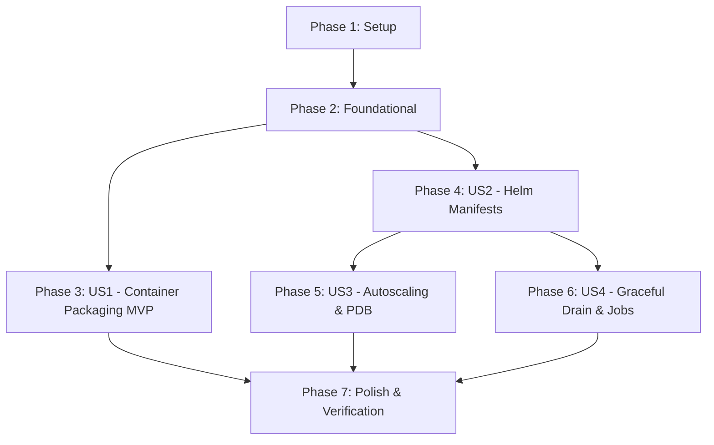

# Tasks: Milestone 007 — Production Container Packaging & Kubernetes Deployment

**Feature**: `007-k8s-production-deployment`  
**Plan**: [plan.md](plan.md)  
**Spec**: [spec.md](spec.md)  

---

## Phase 1: Setup (Shared Infrastructure)

**Purpose**: Scaffolding for Docker packaging, Helm chart directories, and base metadata.

- [ ] T001 [P] Create directory scaffolding for Dockerfiles in `deployments/docker/` and Helm chart in `deployments/helm/pulse/templates/`
- [ ] T002 [P] Create Helm Chart metadata in `deployments/helm/pulse/Chart.yaml`
- [ ] T003 [P] Implement standardized Helm template helpers for names, labels, and selector labels in `deployments/helm/pulse/templates/_helpers.tpl`

---

## Phase 2: Foundational (Blocking Prerequisites)

**Purpose**: Shared Helm values, global cluster ConfigMaps, and encrypted Secrets required by all services.

**⚠️ CRITICAL**: No user story work can begin until this phase is complete.

- [ ] T004 [P] Implement default release configuration values defining microservice images, ports, and resource quotas in `deployments/helm/pulse/values.yaml`
- [ ] T005 [P] Implement shared Kubernetes ConfigMap template defining Redpanda broker endpoints and topic parameters in `deployments/helm/pulse/templates/configmap.yaml`
- [ ] T006 [P] Implement Kubernetes Secret template managing alert webhook URLs and credentials in `deployments/helm/pulse/templates/secret.yaml`

**Checkpoint**: Core Helm packaging foundation and configuration schemas are complete.

---

## Phase 3: User Story 1 - Multi-Stage Minimal Distroless Container Packaging (Priority: P1) 🎯 MVP

**Goal**: Package all 5 platform services (`gateway`, `processor`, `alertd`, `chronod`, `simulator`) into minimal, unprivileged, multi-stage distroless OCI container images with footprints $< 50\text{MB}$ running as non-root user (`UID 65532`).

**Independent Test**: Build all container images using Docker; verify that each image compiles statically with `CGO_ENABLED=0`, contains no shell utilities, and runs as `nonroot` (`UID 65532`).

### Tests for User Story 1

- [ ] T007 [P] [US1] Create unit tests validating Dockerfile multi-stage syntax, non-root user definitions, and entrypoints in `tests/integration/k8s_packaging_test.go`

### Implementation for User Story 1

- [ ] T008 [P] [US1] Implement multi-stage distroless Dockerfile for Ingestion Gateway exposing ports `8080/TCP` and `50051/TCP` in `deployments/docker/Dockerfile.gateway`
- [ ] T009 [P] [US1] Implement multi-stage distroless Dockerfile for Stream Processing Core exposing port `8081/TCP` in `deployments/docker/Dockerfile.processor`
- [ ] T010 [P] [US1] Implement multi-stage distroless Dockerfile for Decoupled Alert Dispatcher exposing port `8083/TCP` in `deployments/docker/Dockerfile.alertd`
- [ ] T011 [P] [US1] Implement multi-stage distroless Dockerfile for ChronoDB Storage Sink exposing ports `8084/TCP` and `50054/TCP` in `deployments/docker/Dockerfile.chronod`
- [ ] T012 [P] [US1] Implement multi-stage distroless Dockerfile for Fleet Load Simulator in `deployments/docker/Dockerfile.simulator`

**Checkpoint**: All 5 container images buildable, unprivileged, and ready for deployment.

---

## Phase 4: User Story 2 - Declarative Helm Chart & Multi-Service Kubernetes Manifests (Priority: P1)

**Goal**: Deploy, configure, and route all 4 core platform daemons (`gateway`, `processor`, `alertd`, `chronod`) across Kubernetes clusters using a unified Helm release.

**Independent Test**: Execute `helm template pulse ./deployments/helm/pulse` and verify rendered YAML manifests for Deployments, Services, and probes conform to Kubernetes API schemas.

### Tests for User Story 2

- [ ] T013 [P] [US2] Create integration tests validating Helm template dry-run rendering and Kubernetes resource definitions in `tests/integration/k8s_packaging_test.go`

### Implementation for User Story 2

- [ ] T014 [P] [US2] Implement Gateway Kubernetes Deployment and Service templates (REST `:8080`, gRPC `:50051`) with `/healthz` probes and resource quotas in `deployments/helm/pulse/templates/gateway-deployment.yaml` and `deployments/helm/pulse/templates/gateway-service.yaml`
- [ ] T015 [P] [US2] Implement Stream Processor Kubernetes Deployment and Service templates (HTTP `:8081`) with `/healthz` probes and resource quotas in `deployments/helm/pulse/templates/processor-deployment.yaml` and `deployments/helm/pulse/templates/processor-service.yaml`
- [ ] T016 [P] [US2] Implement Alert Dispatcher Kubernetes Deployment and Service templates (HTTP `:8083`) with `/healthz` probes and resource quotas in `deployments/helm/pulse/templates/alertd-deployment.yaml` and `deployments/helm/pulse/templates/alertd-service.yaml`
- [ ] T017 [P] [US2] Implement ChronoDB Kubernetes Deployment and Service templates (REST `:8084`, gRPC `:50054`) with `/healthz` probes and resource quotas in `deployments/helm/pulse/templates/chronod-deployment.yaml` and `deployments/helm/pulse/templates/chronod-service.yaml`

**Checkpoint**: Complete Kubernetes multi-service deployment manifests functional.

---

## Phase 5: User Story 3 - Resilient Scaling & Lag-Driven Horizontal Pod Autoscaling (Priority: P2)

**Goal**: Configure metric-driven horizontal pod autoscaling scaling Gateway on CPU utilization and bounding Stream Processor between 1 and 12 replicas to strictly enforce Constitution Principle I (1 worker per partition).

**Independent Test**: Verify rendered HPA manifests assert `minReplicas: 2`, `maxReplicas: 10` for Gateway, and `minReplicas: 1`, `maxReplicas: 12` for Stream Processor.

### Tests for User Story 3

- [ ] T018 [P] [US3] Create integration tests asserting HPA replica bounds and Stream Processor 12-partition ceiling in `tests/integration/k8s_packaging_test.go`

### Implementation for User Story 3

- [ ] T019 [US3] Implement Horizontal Pod Autoscaler for Gateway scaling 2–10 replicas on CPU utilization ($75\%$) in `deployments/helm/pulse/templates/gateway-hpa.yaml`
- [ ] T020 [US3] Implement Horizontal Pod Autoscaler for Stream Processor scaling 1–12 replicas on consumer lag and CPU in `deployments/helm/pulse/templates/processor-hpa.yaml`
- [ ] T021 [P] [US3] Implement Pod Disruption Budget guaranteeing minimum replica availability during voluntary disruptions in `deployments/helm/pulse/templates/pdb.yaml`

**Checkpoint**: Autoscaling policies and high-availability disruption budgets operational.

---

## Phase 6: User Story 4 - Graceful Termination, Secret Configuration & Batch Load Jobs (Priority: P2)

**Goal**: Enforce 30-second graceful connection draining on `SIGTERM` and execute in-cluster synthetic load validation via Kubernetes `Job`.

**Independent Test**: Render and validate the simulator Kubernetes Job template and verify `terminationGracePeriodSeconds: 30` across all Deployment templates.

### Implementation for User Story 4

- [ ] T022 [US4] Configure `terminationGracePeriodSeconds: 30` across all microservice Deployment templates in `deployments/helm/pulse/templates/*-deployment.yaml`
- [ ] T023 [P] [US4] Implement Kubernetes Job template for executing on-demand simulator fleet load tests in `deployments/helm/pulse/templates/simulator-job.yaml`

**Checkpoint**: Safe shutdown lifecycle and synthetic load testing Job configured.

---

## Phase 7: Polish & End-to-End Packaging Verification

**Purpose**: Build automation, packaging validation scripts, and comprehensive documentation.

- [ ] T024 [P] Update `Makefile` with targets `docker-build`, `helm-lint`, `helm-template`, and `k8s-verify` in `Makefile`
- [ ] T025 [P] Implement end-to-end container packaging and Helm template verification script in `scripts/verify_packaging.sh`
- [ ] T026 [P] Update `README.md` and `specs/007-k8s-production-deployment/quickstart.md` with Kubernetes deployment guides and Helm values documentation

---

## Dependencies & Execution Order

### Phase Dependencies

### User Story Dependencies

- **US1 (Container Packaging MVP)**: Multi-stage Dockerfiles can be built and verified independently (T007–T012).
- **US2 (Helm Manifests)**: Depends on Phase 2; defines core Deployments and Services (T013–T017).
- **US3 (Autoscaling & PDB)**: Depends on US2; applies HPA and PDB policies onto US2 Deployments (T018–T021).
- **US4 (Graceful Drain & Jobs)**: Depends on US2; configures pod lifecycle and simulator Job (T022–T023).
- **Polish**: Unifies Makefile and verification scripts (T024–T026).

---

## Parallel Opportunities

- **Phase 1**: T001, T002, T003 can run in parallel (different files in `deployments/helm/pulse/`).
- **Phase 2**: T004, T005, T006 can run in parallel (`values.yaml`, `configmap.yaml`, `secret.yaml`).
- **Phase 3 (Dockerfiles)**: All 5 Dockerfiles (T008, T009, T010, T011, T012) can execute in parallel.
- **Phase 4 (Deployments)**: All 4 microservice templates (T014, T015, T016, T017) can execute in parallel.
- **Phase 7**: T024, T025, T026 can run in parallel.

---

## Implementation Strategy

### MVP First (User Story 1 Only)

1. Complete Phase 1: Setup (`deployments/docker/` and `deployments/helm/pulse/` scaffolding).
2. Complete Phase 2: Foundational (`values.yaml`, `configmap.yaml`, `secret.yaml`).
3. Complete Phase 3: User Story 1 (5 multi-stage distroless Dockerfiles).
4. **Validate MVP**: Build container images; verify size $< 50\text{MB}$ and non-root execution.

### Incremental Delivery

- Step 1: Validate Container Packaging MVP (US1).
- Step 2: Validate Declarative Helm Deployments and Services (US2).
- Step 3: Validate Horizontal Pod Autoscalers and Pod Disruption Budgets (US3).
- Step 4: Validate Termination Grace Period and Simulator Job (US4).
- Step 5: Execute Automated Verification & Polish (Phase 7).
