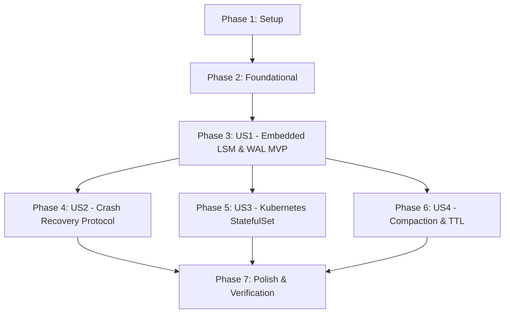

# Tasks: Milestone 008 — ChronoDB Storage Durability & Persistent Volume Orchestration

**Feature**: `008-chronodb-storage-durability`  
**Plan**: [plan.md](plan.md)  
**Spec**: [spec.md](spec.md)  

---

## Phase 1: Setup (Shared Infrastructure)

**Purpose**: Storage configuration options, error constants, and directory scaffolding.

- [ ] T001 [P] Create durable storage configuration options (`DataDir`, `RetentionDays`, `CompactionInterval`) in `internal/storage/config/config.go`
- [ ] T002 [P] Implement storage error definitions (`ErrCorruptWAL`, `ErrDiskFull`, `ErrShardLocked`) in `internal/storage/engine/errors.go`
- [ ] T003 [P] Implement on-disk directory and 16-shard layout scaffolding utility in `internal/storage/engine/layout.go`

---

## Phase 2: Foundational (Blocking Prerequisites)

**Purpose**: Core binary framing, file locking, and catalog persistence primitives required by all user stories.

**⚠️ CRITICAL**: No user story work can begin until this phase is complete.

- [ ] T004 [P] Implement binary WAL framing encoder/decoder with sentinel magic `0x50554C53` and IEEE CRC32 checksums in `internal/storage/engine/wal_frame.go`
- [ ] T005 [P] Implement file lock acquisition (`LOCK`) preventing dual-instance access to data directory in `internal/storage/engine/lock.go`
- [ ] T006 Implement persistent device catalog index serialization and deserialization in `internal/storage/engine/catalog_store.go`

**Checkpoint**: Core binary framing, directory locking, and catalog persistence primitives ready.

---

## Phase 3: User Story 1 - Embedded Disk-Backed LSM Storage Engine & WAL Durability (Priority: P1) 🎯 MVP

**Goal**: Window aggregates and device telemetry durably committed to an embedded LSM-tree disk-backed engine with Write-Ahead Logging (WAL) before consumer offsets are committed.

**Independent Test**: Write 10,000 window aggregates across multiple devices; verify records flush to disk SSTables and WAL; terminate the process (`kill -9`); inspect storage directory and verify 100% of acknowledged records remain intact.

### Tests for User Story 1

- [ ] T007 [P] [US1] Create unit tests for binary WAL frame encoding, decoding, and CRC32 corruption validation in `internal/storage/engine/wal_test.go`

### Implementation for User Story 1

- [ ] T008 [P] [US1] Implement `WALManager` supporting atomic batch append, `fsync` synchronization, and segment rotation in `internal/storage/engine/wal.go`
- [ ] T009 [P] [US1] Implement immutable SSTable file writer and sparse index trailer builder in `internal/storage/engine/sstable_writer.go`
- [ ] T010 [P] [US1] Implement SSTable point-lookup and range-scan reader with bloom filters in `internal/storage/engine/sstable_reader.go`
- [ ] T011 [US1] Implement `DurableEngine` implementing `ChronoEngine` with 16-shard directory routing in `internal/storage/engine/durable.go`
- [ ] T012 [US1] Integrate `DurableEngine` into `cmd/chronod/main.go` using `STORAGE_DATA_DIR`

**Checkpoint**: Embedded disk-backed LSM engine with WAL is operational and implements `ChronoEngine`.

---

## Phase 4: User Story 2 - Crash Recovery Protocol & Replay Invariance (Priority: P1)

**Goal**: Storage service upon restart automatically recovers in-memory index and device catalog from disk SSTables and WAL segments, resuming ingestion from the last committed offset with zero duplicated records or corrupted rollups.

**Independent Test**: Inject mid-write process crashes during active synthetic load; restart storage daemon; query REST/gRPC API across time ranges spanning crash; verify results match pre-crash outputs with 0 duplicated aggregates and 100% catalog integrity (Constitution Principle III).

### Tests for User Story 2

- [ ] T013 [P] [US2] Create integration tests validating ungraceful crash recovery and deduplicated replay in `tests/integration/durable_storage_test.go`

### Implementation for User Story 2

- [ ] T014 [US2] Implement WAL crash recovery replaying uncheckpointed frames and discarding torn trailing writes in `internal/storage/engine/recovery.go`
- [ ] T015 [US2] Implement idempotent duplicate deduplication across SSTables and active memtable in `internal/storage/engine/durable.go`
- [ ] T016 [US2] Update storage consumer sink to enforce WAL sync before partition offset commit in `internal/storage/consumer/sink.go`

**Checkpoint**: Crash recovery protocol and deduplicated replay verified under synthetic crash injection.

---

## Phase 5: User Story 3 - Kubernetes StatefulSet & PersistentVolumeClaim Orchestration (Priority: P2)

**Goal**: Storage service packaged and deployed as a Kubernetes StatefulSet with dedicated PVCs (`volumeClaimTemplates`, `ReadWriteOnce`) mounted at `/var/lib/pulse/chronodb`, maintaining state across pod rescheduling, node evictions, and rolling upgrades.

**Independent Test**: Deploy via Helm on Kubernetes with persistent volume provisioning; ingest aggregated data; delete a storage pod; verify rescheduled replacement pod re-attaches identical PVC, restores state in $<5\text{s}$, and responds to query traffic with zero data loss.

### Tests for User Story 3

- [ ] T017 [P] [US3] Create Helm integration tests validating StatefulSet and PVC template manifests in `tests/integration/k8s_packaging_test.go`

### Implementation for User Story 3

- [ ] T018 [P] [US3] Update `deployments/helm/pulse/values.yaml` with `chronod.persistence` parameters (enabled, size, storageClass, retentionDays)
- [ ] T019 [US3] Implement `chronod-statefulset.yaml` with `volumeClaimTemplates` (`10Gi`, `ReadWriteOnce`) in `deployments/helm/pulse/templates/chronod-statefulset.yaml`
- [ ] T020 [P] [US3] Implement headless service template for StatefulSet peer resolution in `deployments/helm/pulse/templates/chronod-headless-service.yaml`
- [ ] T021 [US3] Update ChronoDB HTTP `/healthz` readiness probe to check disk writeability and available space in `internal/storage/server/http.go`

**Checkpoint**: Kubernetes StatefulSet and PersistentVolumeClaim orchestration operational.

---

## Phase 6: User Story 4 - Background Compaction, Disk Quotas & Time-to-Live (TTL) Pruning (Priority: P2)

**Goal**: Automated background SSTable compaction and TTL-based data retention policies so disk utilization remains bounded, obsolete rollups/tombstones are reclaimed, and read amplification is minimized over long-running workloads.

**Independent Test**: Ingest aggregates configured with a short retention window (e.g., 7 days) and heavy overwrites; trigger background compaction; verify disk space reclamation, tombstone removal, and query latency across valid ranges remains $<2\text{s}$.

### Tests for User Story 4

- [ ] T022 [P] [US4] Create unit tests for multi-way SSTable merge compaction and TTL pruning in `internal/storage/engine/compaction_test.go`

### Implementation for User Story 4

- [ ] T023 [US4] Implement background multi-way merge compaction and TTL tombstone eviction in `internal/storage/engine/compaction.go`
- [ ] T024 [US4] Expose Prometheus metrics for disk usage, compaction duration, and recovery duration in `internal/storage/metrics/metrics.go`

**Checkpoint**: Background compaction and TTL retention pruning functional and observable.

---

## Phase 7: Polish & End-to-End Verification

**Purpose**: Verification scripts, packaging validation, and documentation updates.

- [ ] T025 [P] Update `Makefile` with targets for storage benchmark and persistence verification in `Makefile`
- [ ] T026 [P] Update `scripts/verify_packaging.sh` and `README.md` with ChronoDB persistence documentation
- [ ] T027 Execute full test suite including `-race` and crash recovery invariance validation

---

## Dependencies & Execution Order

### Phase Dependencies

### User Story Dependencies

- **US1 (Embedded LSM & WAL MVP)**: Can start after Foundational phase (T007–T012).
- **US2 (Crash Recovery)**: Depends on US1 WAL and SSTable structures (T013–T016).
- **US3 (StatefulSet & PVCs)**: Depends on US1 data directory structure (T017–T021).
- **US4 (Compaction & TTL)**: Depends on US1 SSTable file formats (T022–T024).
- **Polish**: Final unification and end-to-end verification (T025–T027).

---

## Parallel Opportunities

- **Phase 1**: T001, T002, T003 can execute in parallel (different files in `internal/storage/`).
- **Phase 2**: T004, T005 can execute in parallel (`wal_frame.go` and `lock.go`).
- **Phase 3 (US1)**: T007, T008, T009, T010 can execute in parallel.
- **Phase 5 (US3)**: T017, T018, T020 can execute in parallel.
- **Phase 7**: T025, T026 can execute in parallel.

---

## Implementation Strategy

### MVP First (User Story 1 Only)

1. Complete Phase 1: Setup (`config.go`, `errors.go`, `layout.go`).
2. Complete Phase 2: Foundational (`wal_frame.go`, `lock.go`, `catalog_store.go`).
3. Complete Phase 3: User Story 1 (`wal.go`, `sstable_writer.go`, `sstable_reader.go`, `durable.go`).
4. **Validate MVP**: Ingest aggregates, verify WAL and SSTable creation on disk, kill process and verify files survive.

### Incremental Delivery

- Step 1: Validate Embedded LSM & WAL MVP (US1).
- Step 2: Validate Crash Recovery Protocol & Replay Invariance (US2).
- Step 3: Validate Kubernetes StatefulSet & PVC Orchestration (US3).
- Step 4: Validate Background Compaction & Retention TTL (US4).
- Step 5: Execute Polish & Full End-to-End Verification (Phase 7).
