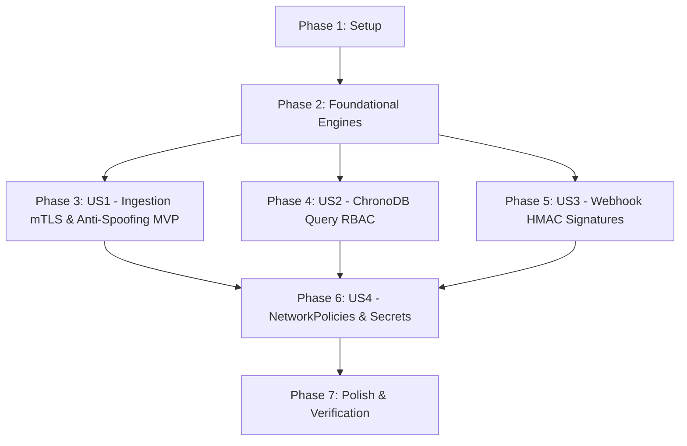

# Tasks: Milestone 009 — Security & Access Control

**Input**: Design documents from `/specs/009-security-access-control/`  
**Prerequisites**: `plan.md`, `spec.md`, `research.md`, `data-model.md`, `contracts/auth-contract.md`, `contracts/networkpolicy-contract.md`, `quickstart.md`

---

## Phase 1: Setup (Shared Security Infrastructure)

**Purpose**: Test certificate generator, security identity types, and audit logging primitives.

- [X] T001 Create local testing certificate generator script in `scripts/generate_certs.sh`
- [X] T002 [P] Define `DeviceIdentity`, `AuthContext`, `Role`, `TokenClaims`, and security errors in `internal/auth/identity.go`
- [X] T003 [P] Implement structured JSON security audit logger for authentication and spoofing events in `internal/auth/audit.go`

---

## Phase 2: Foundational (Core Cryptographic & Security Engines)

**Purpose**: Core cryptographic building blocks required across gateway, query, alert, and webhook components.

**⚠️ CRITICAL**: Foundational tasks must be completed before service-specific user story integrations.

- [X] T004 [P] Implement pre-shared API key validator with constant-time verification in `internal/auth/apikey.go`
- [X] T005 [P] Implement pure Go HMAC-SHA256 (`HS256`) and Ed25519 JWT validator and claims parser in `internal/auth/jwt.go`
- [X] T006 [P] Implement HMAC-SHA256 webhook signer and constant-time verifier with replay protection in `internal/auth/webhook.go`
- [X] T007 [P] Implement in-memory token-bucket rate limiter for perimeter DoS mitigation in `internal/auth/ratelimit.go`

**Checkpoint**: Core cryptographic engines and rate limiting ready for microservice integration.

---

## Phase 3: User Story 1 - Edge Device Ingestion Authentication & Anti-Spoofing (Priority: P1) 🎯 MVP

**Goal**: Ingestion Gateway enforces mTLS X.509 client certificate authentication, validates client Common Name against `reading.device_id` (anti-spoofing), supports constant-time pre-shared API keys, and rate-limits rogue devices.

**Independent Test**: Connect via HTTPS and gRPC with a valid client certificate matching `reading.device_id` and observe 200 OK / gRPC OK; attempt connection without credentials and observe 401 Unauthorized; connect with `turbine-01` certificate asserting `device_id: turbine-02` and observe 403 Forbidden anti-spoofing rejection.

### Tests for User Story 1

- [X] T008 [P] [US1] Create unit and integration tests for mTLS certificate extraction, API key verification, and identity anti-spoofing in `internal/auth/mtls_test.go` and `internal/gateway/server/auth_test.go`

### Implementation for User Story 1

- [X] T009 [P] [US1] Implement X.509 client certificate parser, CA pool loader, and SAN/CN device binding in `internal/auth/mtls.go`
- [X] T010 [P] [US1] Implement Gateway HTTP authentication and anti-spoofing middleware in `internal/auth/http_middleware.go`
- [X] T011 [P] [US1] Implement Gateway gRPC authentication and anti-spoofing interceptors in `internal/auth/grpc_interceptor.go`
- [X] T012 [US1] Update Gateway configuration to support TLS, client CA paths, API key files, and rate limits in `internal/gateway/config/config.go`
- [X] T013 [US1] Integrate authentication middleware, rate limiting, and gRPC interceptors into `internal/gateway/server/http.go` and `internal/gateway/server/grpc.go`
- [X] T014 [US1] Expose authentication outcome Prometheus metrics (`pulse_ingest_auth_successes_total`, `pulse_ingest_auth_failures_total`) in `internal/gateway/metrics/metrics.go`

**Checkpoint**: Ingestion Gateway perimeter security operational with mTLS, API keys, anti-spoofing, and rate limiting.

---

## Phase 4: User Story 2 - ChronoDB Query API Authentication & RBAC (Priority: P1)

**Goal**: ChronoDB REST and gRPC query servers require Bearer JWT tokens and enforce `Viewer`, `Operator`, and `Admin` role scopes and device tenant isolation boundaries.

**Independent Test**: Issue query requests with valid `Viewer` token and observe 200 OK; query administrative endpoints with `Viewer` token and observe 403 Forbidden; query device ID outside authorized token scopes and observe 403 Forbidden; query without credentials and observe 401 Unauthorized.

### Tests for User Story 2

- [X] T015 [P] [US2] Create unit and integration tests for Bearer JWT parsing, role validation (`Viewer`, `Operator`, `Admin`), and device scope boundary checks in `internal/storage/server/auth_test.go`

### Implementation for User Story 2

- [X] T016 [P] [US2] Update ChronoDB configuration to support JWT secret, issuer, and RBAC parameters in `internal/storage/config/config.go`
- [X] T017 [US2] Implement ChronoDB HTTP query authentication and RBAC evaluation middleware in `internal/storage/server/http.go`
- [X] T018 [US2] Implement ChronoDB gRPC query authorization interceptor in `internal/storage/server/grpc.go`
- [X] T019 [US2] Expose storage authentication failure Prometheus metrics (`pulse_storage_auth_failures_total`) in `internal/storage/metrics/metrics.go`

**Checkpoint**: ChronoDB historical queries and rollups secured with JWT and role-based access control.

---

## Phase 5: User Story 3 - Decoupled Webhook Integrity & HMAC-SHA256 Signatures (Priority: P2)

**Goal**: Outbound alert notifications from `alertd` are cryptographically signed with HMAC-SHA256 headers (`X-Pulse-Signature`, `X-Pulse-Timestamp`), with receiver verification utilities defending against payload tampering and replay attacks.

**Independent Test**: Trigger an anomaly alert dispatch; verify outbound HTTP headers contain valid HMAC signature and timestamp; verify test receiver verifies authenticity; tamper with payload bytes or inject timestamp $>300\text{s}$ old and verify rejection.

### Tests for User Story 3

- [X] T020 [P] [US3] Create unit tests for alert webhook HMAC signing, timestamp header validation, and replay rejection in `internal/alert/sink/webhook_security_test.go`

### Implementation for User Story 3

- [X] T021 [P] [US3] Update alert dispatcher configuration to support `WebhookHMACSecret` in `internal/alert/config/config.go`
- [X] T022 [US3] Update `internal/alert/sink/webhook.go` to compute HMAC-SHA256 and attach `X-Pulse-Signature` and `X-Pulse-Timestamp` headers
- [X] T023 [US3] Implement downstream webhook verification helper SDK in `pkg/webhookverifier/verifier.go`

**Checkpoint**: Outbound alert webhooks cryptographically signed and replay-protected.

---

## Phase 6: User Story 4 - Kubernetes NetworkPolicies & Secret Management (Priority: P2)

**Goal**: Pulse Helm chart provisions default-deny ingress `NetworkPolicy` resources and volume-mounted Kubernetes `Secret` resources (`mode: 0400`) for all microservices running under non-root distroless security contexts (`UID 65532`).

**Independent Test**: Render Helm manifests with `security.networkPolicies.enabled=true`; verify default-deny policy, gateway egress rules, processor egress rules, alertd egress rules, and chronod ingress rules match security contract; verify secret templates mount credentials read-only.

### Tests for User Story 4

- [X] T024 [P] [US4] Create Helm integration tests validating `NetworkPolicy` manifests and `Secret` templates in `tests/integration/k8s_security_test.go`

### Implementation for User Story 4

- [X] T025 [P] [US4] Update `deployments/helm/pulse/values.yaml` with `security.networkPolicies` and `security.secrets` configuration parameters
- [X] T026 [US4] Implement default-deny and inter-service least-privilege `NetworkPolicy` manifests in `deployments/helm/pulse/templates/networkpolicy.yaml`
- [X] T027 [US4] Implement Kubernetes `Secret` templates for TLS certificates, JWT secrets, and HMAC signing keys in `deployments/helm/pulse/templates/secrets.yaml`

**Checkpoint**: Kubernetes network traffic isolated and secrets managed via native Kubernetes Secrets.

---

## Phase 7: Polish & End-to-End Verification

**Purpose**: Developer tooling, build targets, documentation, and end-to-end race validation.

- [X] T028 [P] Update `Makefile` with targets for certificate generation (`make certs`) and security verification in `Makefile`
- [X] T029 [P] Update `scripts/verify_packaging.sh` and `README.md` with Milestone 009 security documentation, mTLS guide, and RBAC instructions
- [X] T030 Execute full test suite including `-race`, security penetration tests, and timing invariance validation

---

## Dependencies & Execution Order

### Phase Dependencies

### User Story Dependencies

- **US1 (Ingestion mTLS & Anti-Spoofing)**: Depends on Foundational components (T004, T007) — Independent MVP.
- **US2 (ChronoDB Query RBAC)**: Depends on Foundational JWT engine (T005) — Independent from US1.
- **US3 (Webhook HMAC Signatures)**: Depends on Foundational HMAC engine (T006) — Independent from US1/US2.
- **US4 (Kubernetes NetworkPolicies & Secrets)**: Depends on service configurations established across US1–US3.
- **Polish**: Final verification across all components.

---

## Parallel Opportunities

- **Phase 1**: T002 and T003 can execute in parallel.
- **Phase 2**: T004, T005, T006, and T007 can all execute in parallel (different standalone files in `internal/auth/`).
- **Phase 3 (US1)**: T008, T009, T010, and T011 can execute in parallel.
- **Phase 4 (US2)**: T015 and T016 can execute in parallel.
- **Phase 5 (US3)**: T020 and T021 can execute in parallel.
- **Phase 6 (US4)**: T024 and T025 can execute in parallel.
- **Phase 7**: T028 and T029 can execute in parallel.

---

## Implementation Strategy

### MVP First (User Story 1 Only)

1. Complete Phase 1: Setup (`generate_certs.sh`, `identity.go`, `audit.go`).
2. Complete Phase 2: Foundational (`apikey.go`, `jwt.go`, `webhook.go`, `ratelimit.go`).
3. Complete Phase 3: User Story 1 (`mtls.go`, `http_middleware.go`, `grpc_interceptor.go`, gateway integration).
4. **Validate MVP**: Ingest with valid client certs, test anti-spoofing CN mismatch rejection, test API key verification, and verify perimeter rejection of unauthenticated clients.

### Incremental Delivery

- **Increment 1**: Deliver Edge Ingestion mTLS, API Keys, and Anti-Spoofing (US1 - MVP).
- **Increment 2**: Deliver ChronoDB Query JWT Authentication & RBAC (US2).
- **Increment 3**: Deliver Webhook HMAC-SHA256 Signing and Replay Protection (US3).
- **Increment 4**: Deliver Kubernetes NetworkPolicies and Secret Management (US4).
- **Increment 5**: Complete Polish, documentation, and `-race` test validation (Phase 7).

