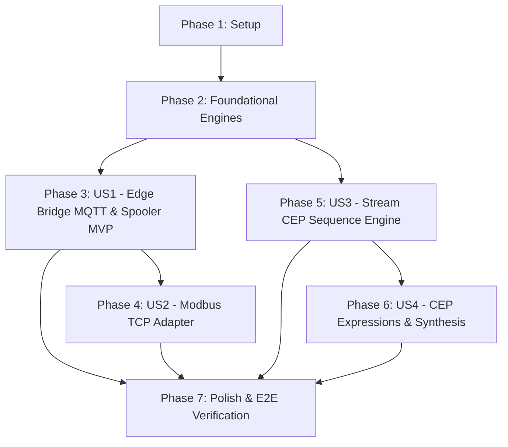

# Tasks: Milestone 010 — Industrial Edge Bridge & Complex Event Processing (CEP) Engine

**Input**: Design documents from `/specs/010-edge-bridge-cep/`  
**Prerequisites**: `plan.md`, `spec.md`, `research.md`, `data-model.md`, `contracts/bridge-contract.md`, `contracts/cep-contract.md`, `quickstart.md`

---

## Phase 1: Setup (Shared Infrastructure & Protocol Contracts)

**Purpose**: Configuration structures, protocol interfaces, and CEP data types.

- [ ] T001 Create bridge configuration models and environment loader in `internal/bridge/config/config.go`
- [ ] T002 [P] Define `ProtocolAdapter`, `OfflineSpooler`, and `GatewayForwarder` interfaces in `internal/bridge/adapter/adapter.go`
- [ ] T003 [P] Define `CEPEngine`, `CEPRule`, and `SequenceCandidate` core types in `internal/processor/cep/types.go`

---

## Phase 2: Foundational (Core Ingestion, Buffering & Rule Compilation Engines)

**Purpose**: Core spooling, forwarding, rule compilation, and metric primitives required across bridge and processor.

**⚠️ CRITICAL**: Foundational tasks must be completed before user story implementations.

- [ ] T004 [P] Implement disk-backed FIFO ring buffer spooler with binary framing (`PUBR`) and manifest tracking in `internal/bridge/spooler/spooler.go` and `internal/bridge/spooler/manifest.go`
- [ ] T005 [P] Implement authenticated mTLS gRPC streaming forwarder client with automatic reconnection and backoff in `internal/bridge/forwarder/forwarder.go`
- [ ] T006 [P] Implement declarative CEP rule parser and validator for YAML/JSON definitions in `internal/processor/cep/rule.go`
- [ ] T007 [P] Expose Prometheus metrics for bridge buffer stats, MQTT throughput, and CEP evaluations in `internal/bridge/metrics/metrics.go` and `internal/processor/metrics/metrics.go`

**Checkpoint**: Core spooling, gRPC forwarding, and CEP rule compiler ready for protocol and stream integration.

---

## Phase 3: User Story 1 - Industrial MQTT & Sparkplug B Ingestion with Offline Buffering (Priority: P1) 🎯 MVP

**Goal**: `pulse-bridge` subscribes to factory MQTT v3.1.1/v5.0 and Sparkplug B topics, normalizes payloads to Protobuf `TelemetryReading`, streams over mTLS gRPC to `pulse-gateway`, and spools to local disk during network disconnects.

**Independent Test**: Connect `pulse-bridge` to a local MQTT broker publishing machine topics; verify telemetry is normalized and streamed to `pulse-gateway`; sever connection to gateway, verify disk spooling; reconnect gateway, verify chronological backfill with zero loss.

### Tests for User Story 1

- [ ] T008 [P] [US1] Create unit tests for MQTT JSON payload decoding, Sparkplug B parsing, and offline spooling in `internal/bridge/adapter/mqtt_test.go` and `internal/bridge/spooler/spooler_test.go`

### Implementation for User Story 1

- [ ] T009 [P] [US1] Implement MQTT v3/v5 protocol adapter with topic wildcard subscription and JSON metric mapping in `internal/bridge/adapter/mqtt.go`
- [ ] T010 [P] [US1] Implement Sparkplug B payload decoder mapping metric aliases and timestamps to `TelemetryReading` in `internal/bridge/adapter/sparkplug.go`
- [ ] T011 [US1] Implement bridge coordinator pipeline integrating MQTT adapters, offline spooler, and gRPC forwarder in `internal/bridge/coordinator.go`
- [ ] T012 [US1] Create standalone bridge daemon entrypoint in `cmd/bridge/main.go`

**Checkpoint**: Standalone `pulse-bridge` operational with MQTT/Sparkplug B ingestion, offline store-and-forward spooling, and mTLS gRPC forwarding (MVP).

---

## Phase 4: User Story 2 - Modbus TCP & OPC-UA Equipment Polling & Normalization (Priority: P2)

**Goal**: `pulse-bridge` cyclically polls Modbus TCP slave holding/input registers, applies linear scaling equations and endian conversions, and streams normalized readings to gateway.

**Independent Test**: Configure Modbus polling against mock PLC server; verify register values scaled and streamed as `TelemetryReading`s; verify automatic reconnection on timeout.

### Tests for User Story 2

- [ ] T013 [P] [US2] Create unit tests for Modbus TCP register polling, data type decoding (int16, float32_be/le), and scaling in `internal/bridge/adapter/modbus_test.go`

### Implementation for User Story 2

- [ ] T014 [P] [US2] Implement Modbus TCP master client with FC03/FC04 register polling, endian decoding, and linear scaling in `internal/bridge/adapter/modbus.go`
- [ ] T015 [US2] Integrate Modbus adapter into bridge coordinator in `internal/bridge/coordinator.go`

**Checkpoint**: Legacy Modbus TCP PLCs actively polled and normalized alongside MQTT streams.

---

## Phase 5: User Story 3 - Partition-Local Temporal Sequence Pattern Evaluation (`FOLLOWED_BY`, `WITHIN`) (Priority: P1)

**Goal**: Stream processor evaluates sequential event-time patterns (`EventA FOLLOWED_BY EventB WITHIN ΔT`) in partition-local memory with zero cross-goroutine locking, with candidates expired by event-time watermarks.

**Independent Test**: Define `vibration` followed by `temperature` within 30s rule; stream matching sequence within 15s and observe composite detection; stream sequence with 45s gap and observe watermark-driven candidate expiration.

### Tests for User Story 3

- [ ] T016 [P] [US3] Create unit tests for sequence matching, event-time sliding windows, and watermark expiration in `internal/processor/cep/sequence_test.go`

### Implementation for User Story 3

- [ ] T017 [P] [US3] Implement NFA sequence pattern matcher and in-flight candidate state machine in `internal/processor/cep/sequence.go`
- [ ] T018 [P] [US3] Implement watermark-based candidate cleanup and memory bounds in `internal/processor/cep/candidate.go`
- [ ] T019 [US3] Integrate CEP engine into partition consumer loop in `internal/processor/consumer/consumer.go`

**Checkpoint**: Stream processor executes zero-lock partition-local temporal sequence evaluations.

---

## Phase 6: User Story 4 - Cross-Metric Mathematical Expressions, Composite Incident Synthesis & Live Rule Reloading (Priority: P2)

**Goal**: CEP engine evaluates cross-metric arithmetic formulas, synthesizes cascading multi-metric alerts into unified `CompositeIncidentEvent`s for `alertd`, and reloads rules live without restarts.

**Independent Test**: Evaluate formula `power_mw / fuel_flow < 0.70` across correlated metrics; verify composite incident generated with initiating trigger and secondary symptoms; trigger live reload and verify updated rule takes effect without event loss.

### Tests for User Story 4

- [ ] T020 [P] [US4] Create unit tests for arithmetic expression parsing, composite incident synthesis, and dynamic rule reload in `internal/processor/cep/expression_test.go` and `internal/processor/cep/reload_test.go`

### Implementation for User Story 4

- [ ] T021 [P] [US4] Implement cross-metric arithmetic expression tokenizer and AST evaluator in `internal/processor/cep/expression.go`
- [ ] T022 [US4] Implement composite incident synthesizer producing structured `CompositeIncidentEvent` alerts to `telemetry.alerts` in `internal/processor/cep/synthesizer.go`
- [ ] T023 [US4] Implement live atomic rule registry swap and administrative reload handler (`POST /api/v1/rules/reload` & SIGHUP) in `internal/processor/cep/reload.go` and `internal/processor/server/http.go`

**Checkpoint**: Advanced multivariate arithmetic and noise-reducing composite incident synthesis operational with live rule reloading.

---

## Phase 7: Polish & End-to-End Verification

**Purpose**: Developer tooling, build targets, documentation, and end-to-end race validation.

- [ ] T024 [P] Create sample configuration manifests in `deployments/config/bridge.yaml` and `deployments/config/cep_rules.yaml`
- [ ] T025 [P] Create end-to-end integration test validating Bridge $\rightarrow$ Gateway $\rightarrow$ Redpanda $\rightarrow$ Processor with CEP $\rightarrow$ Alertd in `tests/integration/edge_cep_test.go`
- [ ] T026 [P] Update `Makefile` with targets for bridge binary build (`cmd/bridge`), Docker packaging (`Dockerfile.bridge`), and CEP tests
- [ ] T027 [P] Update `README.md` with Milestone 010 documentation, protocol bridge configuration, and CEP rule guide
- [ ] T028 Execute full test suite including `-race` and benchmark verification

---

## Dependencies & Execution Order

### Phase Dependencies

### User Story Dependencies

- **US1 (Edge Bridge MQTT & Spooler)**: Depends on Foundational components (T004, T005) — Independent MVP.
- **US2 (Modbus TCP Adapter)**: Depends on US1 coordinator (T011) and foundational spooler (T004).
- **US3 (CEP Sequence Engine)**: Depends on Foundational rule compiler (T006) — Independent from Edge Bridge.
- **US4 (CEP Expressions & Synthesis)**: Depends on US3 sequence candidate model (T017, T018).
- **Polish**: Final multi-service integration across all components.

---

## Parallel Opportunities

- **Phase 1**: T002 and T003 can execute in parallel.
- **Phase 2**: T004, T005, T006, and T007 can all execute in parallel (distinct subsystems in bridge and processor).
- **Phase 3 (US1)**: T008, T009, and T010 can execute in parallel.
- **Phase 4 (US2)**: T013 and T014 can execute in parallel.
- **Phase 5 (US3)**: T016, T017, and T018 can execute in parallel.
- **Phase 6 (US4)**: T020 and T021 can execute in parallel.
- **Phase 7**: T024, T025, T026, and T027 can all execute in parallel.

---

## Implementation Strategy

### MVP First (User Story 1 Only)

1. Complete Phase 1: Setup (`config.go`, interfaces, types).
2. Complete Phase 2: Foundational (`spooler.go`, `forwarder.go`, `rule.go`, `metrics.go`).
3. Complete Phase 3: User Story 1 (`mqtt.go`, `sparkplug.go`, `coordinator.go`, `cmd/bridge`).
4. **Validate MVP**: Ingest MQTT topics, verify gRPC forwarding to gateway, sever connection to test offline disk spooling, and reconnect to verify chronological backfill.

### Incremental Delivery

- **Increment 1**: Deliver Edge Bridge MQTT, Sparkplug B, and Offline Spooling (US1 - MVP).
- **Increment 2**: Deliver Modbus TCP Industrial PLC Polling (US2).
- **Increment 3**: Deliver Zero-Lock Partition-Local CEP Sequence Engine (US3).
- **Increment 4**: Deliver Cross-Metric Expressions, Composite Incident Synthesis, and Live Rule Reloading (US4).
- **Increment 5**: Complete Polish, Dockerfile packaging, and `-race` E2E test validation (Phase 7).

